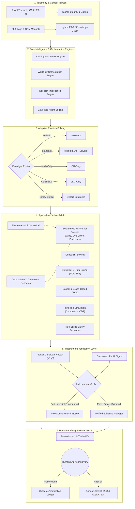
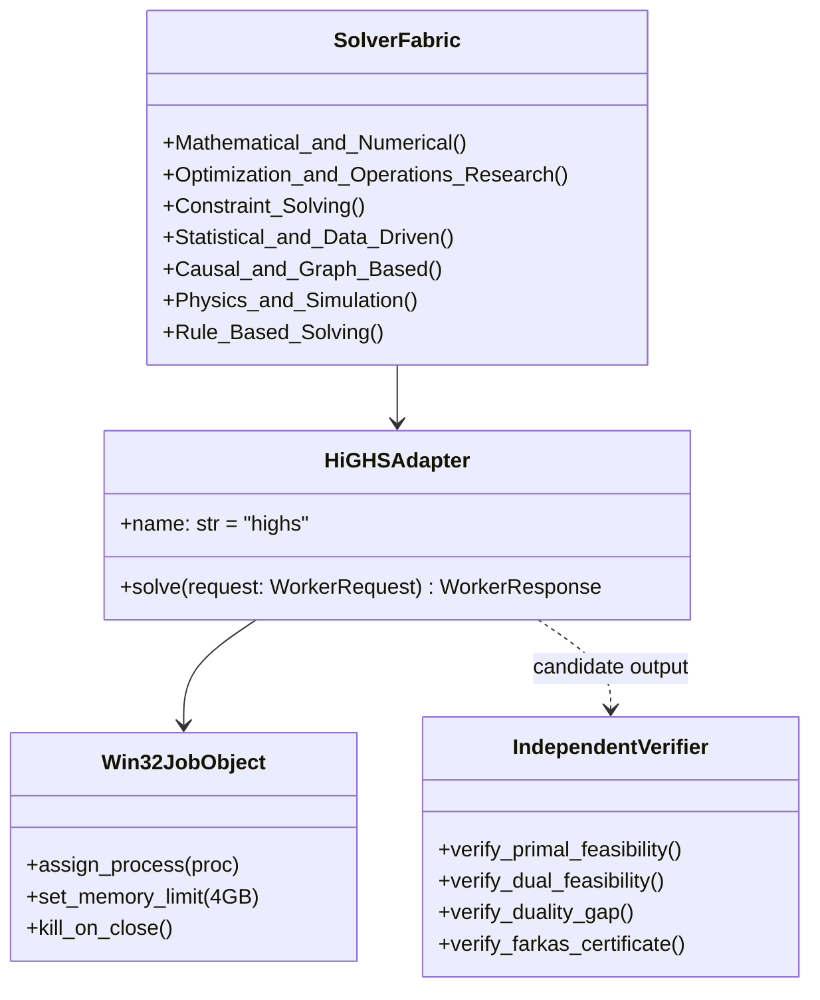

# QORVEXA

**Industrial AI Research Lab**  
*Industrial Decision Intelligence Platform*

> **"From Industrial Complexity to Verified Decisions."**

[](https://qorvexa-delta.vercel.app)
[](docs/qorvexa/)
[](https://www.python.org/)
[](https://fastapi.tiangolo.com/)
[](https://react.dev/)
[](https://www.typescriptlang.org/)
[](LICENSE)

---

## 1. Executive Overview

**QORVEXA** transforms complex industrial problems into explainable, mathematically grounded, independently verified decisions through AI-assisted problem understanding, specialized solvers, simulation, and governed decision workflows.

Industrial facilities face high-stakes operational trade-offs across asset maintenance, energy efficiency, production scheduling, and component degradation. Pure Large Language Models (LLMs) hallucinate constraints and cannot provide mathematical optimality proofs. Conversely, classical Operations Research (OR) and simulation tools lack contextual agility, struggle with unstructured plant documentation, and remain opaque to operations engineers.

QORVEXA bridges this divide:
- **LLMs interpret, formulate, and coordinate** — they never serve as the unverified source of mathematical truth.
- **Specialized solvers execute** — numerical solutions derive from dedicated, isolated mathematical engines (e.g., HiGHS continuous LP).
- **Independent verification validates** — candidate solver solutions must pass rigorous mathematical feasibility and certificate checks before reaching human engineers.
- **Strict safety governance** — QORVEXA is **100% advisory and read-only**; it never writes to PLCs, changes setpoints, or actuates machinery.

```
SENSE → VALIDATE → UNDERSTAND → RETRIEVE → DIAGNOSE → ASSESS UNCERTAINTY → 
FORMULATE → SELECT METHOD → SOLVE → SIMULATE → VERIFY → ASSESS TRADE-OFFS → 
HUMAN REVIEW → VERIFY OUTCOME → LEARN
```

---

## 2. Core Architecture

QORVEXA decouples contextual understanding, mathematical solving, and safety verification into four specialized platform engines, a multi-paradigm Solver Fabric, and an independent verification layer.



---

## 3. Four Intelligence & Orchestration Engines

The platform is driven by four dedicated engines that manage context, coordinate workflows, evaluate trade-offs, and enforce safety:

| Engine | Primary Responsibility | Key Capabilities |
| :--- | :--- | :--- |
| **1. Ontology & Context Engine** | Grounding physical assets and operating context | Digital Asset Passports, physical sensor topologies, operating regime identification (loaded vs unloaded), and component relationship trees. |
| **2. Workflow Orchestration Engine** | Deterministic pipeline state execution | Multi-stage lifecycle execution, worker timeout watchdogs, memory commit limits, error handling, and clean fallback routing. |
| **3. Decision Intelligence Engine** | Multi-objective trade-off evaluation | Pareto frontier extraction (maintenance cost vs downtime risk vs energy penalty), uncertainty calibration, and economic consequence estimation. |
| **4. Governed Agent Engine** | Safe, auditable AI agency | Sandboxed tool calling, epistemic labeling (facts vs assumptions), explicit human review checkpoints, and immutable cryptographic audit logging. |

---

## 4. The Specialized Solver Fabric

The **Solver Fabric** is QORVEXA's modular computational ecosystem. Rather than relying on a single monolithic optimizer, the fabric provides specialized engines behind typed runtime contracts:



1. **Mathematical & Numerical**: Exact fraction arithmetic (`Fraction`), arbitrary-precision bounds, bounded continuous LP, and HiGHS simplex/IPM execution.
2. **Optimization & Operations Research**: Continuous linear programming, capacity-constrained production scheduling, resource allocation, and multi-scenario optimization.
3. **Constraint Solving**: Temporal intervals, operating regime rules, Boolean satisfiability, and multi-variable bound conflict detection.
4. **Statistical & Data-Driven**: PCA with Squared Prediction Error (PCA-SPE), Out-of-Distribution (OOD) abstention probes, and conformal prediction bands.
5. **Causal & Graph-Based**: Root Cause Analysis (RCA), causal Bayesian graphs, physical topology traversals, and fault propagation trees.
6. **Physics & Simulation**: First-principles compressor thermo-pneumatics (MetroPT-3), fluid pressure decay models, and synthetic benchmark degradation (AI4I 2020).
7. **Rule-Based Solving**: Deterministic engineering safety limits, ISO/IEC maintenance envelopes, and fail-safe interlocks.

---

## 5. Adaptive Multi-Paradigm Problem-Solving

QORVEXA operates across five distinct problem-solving paradigms to adapt to real-world industrial constraints:

- **Automatic (Default)**: Fully autonomous problem intake, regime detection, solver dispatch, and multi-tier verification. Recommended for standard production operations.
- **Hybrid (LLM + Solvers)**: LLMs extract constraints, parameters, and business goals from unstructured shift logs, compiling them into canonical formulations for mathematical solvers.
- **OR-Only**: Bypasses generative AI entirely. Ingests structured telemetry directly into canonical LP formulations with exact arithmetic and deterministic guarantees.
- **LLM-Only**: Engaged only when telemetry is unobservable or problems cannot be mathematically grounded. Provides qualitative synthesis with explicit non-mathematical epistemic warnings.
- **Expert-Controlled**: Senior plant engineers explicitly specify solver algorithms, tolerance bounds, objective weights, and verification rules for safety-critical plant workflows.

---

## 6. End-to-End Decision Workflow


1. **Sense**: Stream high-frequency telemetry (air pressure, motor current, oil temperature) and operational events.
2. **Validate**: Signal integrity filtering, sensor range checks, and operating regime separation (loaded vs unloaded).
3. **Understand**: Contextual semantic extraction from maintenance logs and shift handover records.
4. **Retrieve**: Hybrid RAG querying across engineering manuals, OEM schematics, and incident histories.
5. **Diagnose**: Multi-hypothesis Root Cause Analysis (RCA) ranking physical failure mechanisms.
6. **Assess Uncertainty**: OOD abstention scoring and telemetry calibration confidence checks.
7. **Formulate**: Compile business and physical requirements into canonical mathematical models (`CanonicalLP`).
8. **Select Method**: Determine the appropriate paradigm and solver engine based on tractability and constraints.
9. **Solve**: Execute optimization in an isolated child subprocess under strict resource limits.
10. **Simulate**: Evaluate candidate outcomes through physical Digital Twin simulation models.
11. **Verify**: Independent mathematical verification of primal feasibility, dual bounds, and complementarity.
12. **Assess Impact & Trade-offs**: Multi-objective Pareto evaluation across financial cost, reliability, and downtime.
13. **Human Review**: Mandatory advisory presentation to authorized plant engineers for review and sign-off.
14. **Verify Outcome & Learn**: Append-only outcome ledger comparing actual maintenance findings to diagnoses.

---

## 7. First Implemented Domain Vertical: Production Planning

The first production-grade domain vertical implemented on the Solver Fabric is continuous **Production Planning**:

- **Continuous Decision Quantities**: Models production volumes ($x_j \ge 0$) across continuous multi-product lines.
- **Resource Capacities & Consumption**: Enforces shared resource limits (labor, machine runtime, raw materials):
  $$\sum_{j} A_{i,j} x_j \le b_i \quad \forall i \in \text{Resources}$$
- **Market Demand Bounds**: Lower contract commitments and upper demand absorption caps ($d_j^{\min} \le x_j \le d_j^{\max}$).
- **Dual Business Objectives**: Margin maximization ($\max \sum m_j x_j$) or unit production cost minimization.
- **Deterministic Compilation**: Compiles domain entities to canonical CSR format with deterministic IR SHA-256 digests.
- **Traceability Manifest**: Bidirectional mapping linking business entity names directly to matrix row/column indices.
- **Independent Scenarios**: Capacity expansion, demand surge, and supply disruption counterfactuals.
- **Evidence-Gated Reports**: Analytical report generation is strictly gated by trusted solver verification evidence.
- **Verification Evidence**: **64 dedicated unit/integration tests passed** and **220 combined tests passed**.

---

## 8. Industrial Language Understanding & Factory Terminology

To bridge colloquial shop-floor communication and formal optimization models, QORVEXA implements a 13-stage deterministic, bounded language intelligence pipeline (`qorvexa.industrial.understanding`):

- **Multilingual Factory Intake**: Direct support for Egyptian Colloquial Arabic (`عامية مصري`), Modern Standard Arabic (`فصحى`), English, shop-floor code-switching, and Arabizi numerals and terminology.
- **Quote-Grounded Claims**: Every extracted parameter, constraint, and capacity is strictly bound to verbatim character offsets within the source shift notes; fabricated, ungrounded, or distorted claims are marked `UNSUPPORTED` or `CONFLICTED`.
- **Contradiction & Conflict Detection**: Evaluates numeric assertions within identical operational scopes (converting dimensional units exactly), surfacing mathematical and physical contradictions prior to formulation.
- **Factory-Scoped Versioned Terminology**: Plant jargon, equipment aliases, and local product names are managed in factory-isolated dictionaries (`TerminologyBook`). Changes require an authorized human `TERMINOLOGY_REVIEWER`, appending immutable version events with full audit tracking.
- **Untrusted Proposals Pipeline**: Extracted operational claims are emitted exclusively as untrusted `PROPOSAL` entries into the Fact Ledger (`emit_proposals`). LLMs cannot confirm facts, alter models, or trigger optimization runs autonomously.
- **Interactive Clarification Loop**: Automatically identifies missing parameters (capacity gaps, undefined cost metrics) and prompts plant operators in their native language and dialect with targeted, non-duplicative questions.

---

## 9. Discrete-Event Digital Twin & Simulation Engine

To model operational dynamics that cannot be captured by static continuous LP formulations (such as buffer capacities, machine starvations, upstream blocking, stochastic shift downtime, and scrap generation), QORVEXA implements a high-performance Discrete-Event Simulation (DES) engine (`qorvexa.industrial.digital_twin`):

- **Integer Tick Clock**: High-resolution integer-second event scheduler; durations are converted exactly by the Units Engine with zero silent rounding.
- **Micro-State Machine Tracking**: Every machine instant is rigorously classified into exactly one mutually exclusive operational state (`PROCESSING`, `SETUP`, `BLOCKED`, `STARVED`, `WAITING_RESOURCE`, `DOWN`, `PLANNED_DOWNTIME`, `OFF_SHIFT`).
- **Piece Conservation & Balances**: Validates exact mass and piece conservation across buffers, processing stations, and scraps (`Conservation.balanced`).
- **Stochastic Disturbance Streams**: Independent, deterministic SHA-256 pseudo-random streams per `(seed, replication, stream)` generating bit-identical reproducible Monte Carlo executions (Triangular, Exponential, and Bernoulli distributions).
- **Lineage-Checked Scenarios**: Immutable counterfactual scenario branches (`SimulationEvidence`) recording bottleneck candidates, machine utilization, WIP accumulation, and lateness distributions.

---

## 10. Optimization–Simulation Co-Orchestration (OSCO)

A mathematically optimal plan is not automatically operationally viable on the factory floor. QORVEXA's Optimization–Simulation Co-Orchestration engine (`qorvexa.industrial.co_orchestration`) couples continuous mathematical optimization with discrete-event operational simulation in an iterative, evidence-grounded refinement loop:

$$\text{Admitted Formulation} \longrightarrow \text{HiGHS Solve} \longrightarrow \text{Independent Verification} \longrightarrow \text{Digital Twin DES} \longrightarrow \text{Operational Violation Detection} \longrightarrow \text{Evidence-Justified Refinement} \longrightarrow \text{Re-Optimization} \longrightarrow \text{Pareto Decision Package}$$

- **Closed-Loop Feedback**: If a mathematically optimal plan causes buffer overflow, machine deadlock, or delivery lateness in simulation, OSCO pinpoints the responsible operational bottleneck.
- **Evidence-Justified Refinements**: Only proposes adjustments whose numeric bounds are directly justified by scheduled productive calendar time (`shifts - breaks - planned downtime - breakdowns`); capacities are never arbitrarily altered.
- **Integrated Decision Intelligence**: Unifies mathematical objectives (profit, cost) with simulated operational metrics (WIP, throughput, makespan, late orders) into Pareto frontiers and multi-criteria ranking packages awaiting explicit human sign-off.

---

## 11. Accurate Implementation Status

To preserve engineering integrity, QORVEXA explicitly demarcates verified code from active work and planned architecture:

| Component | Status | Test / Evidence Reference |
| :--- | :---: | :--- |
| **Solver Fabric Runtime Contracts** | **Implemented & Tested** | `tests/test_sf_runtime_contracts.py`, `test_sf_canonical_lp.py` (593 tests passed) |
| **Exact Arithmetic & Math Hardening** | **Implemented & Tested** | `tests/test_sf_exact.py`, `test_sf_math_hardening.py` |
| **HiGHS Worker & Adapter (Win32 Isolated)** | **Implemented & Tested** | `tests/test_sf_highs_adapter.py` (21/21 passed; Win32 Job Object, 4GB cap) |
| **Independent Mathematical Verifier** | **Implemented & Tested** | `tests/test_sf_verifier.py` (primal/dual feasibility, duality gap, Farkas rays) |
| **Production Planning Formulation Slice** | **Implemented & Tested** | `tests/test_production_planning.py` (64/64 dedicated passed; 220 combined) |
| **Industrial Language Understanding** | **Implemented & Tested** | `tests/test_industrial_understanding.py` (43/43 passed; 13-stage pipeline) |
| **Factory Terminology Lifecycle & Isolation** | **Implemented & Tested** | `tests/test_industrial_understanding_api.py` (18/18 passed; SQLite versioned store) |
| **Dimensional Units Verification Engine** | **Implemented & Tested** | `tests/test_industrial_units.py` (64/64 passed; dimensional checking) |
| **Fact Ledger & Governed Sessions (SQLite WAL)** | **Implemented & Tested** | `tests/test_governance.py`, `test_formulation.py` (tamper-evident hash chain) |
| **Decision Intelligence & Pareto Frontier** | **Implemented & Tested** | `tests/test_decision_intelligence*.py` (multi-scenario ranking & trade-offs) |
| **Discrete-Event Digital Twin Simulator** | **Implemented & Tested** | `tests/test_industrial_digital_twin.py` (55/55 passed; micro-state accounting) |
| **Optimization-Simulation Co-Orchestration** | **Implemented & Tested** | `tests/test_optimization_simulation_orchestration.py` (24/24 passed; closed-loop) |
| **Phase B End-to-End Orchestrator Binding** | **Implemented & Tested** | `tests/test_sf_phase_b_integration.py` (21/21 passed) |
| **Live HiGHS Solves on Production Planning** | **Implemented & Tested** | `tests/test_industrial_api_e2e.py` (verified with real HiGHS subprocess) |
| **MetroPT-3 Real Telemetry Anomaly Detection** | **Implemented & Tested** | `tests/test_anomaly_*.py` (4/4 operator leak episodes detected; 0.026 FA/day) |
| **Cryptographic Audit Trail (SHA-256)** | **Implemented & Tested** | `tests/test_audit_contention.py` (tamper-evident hash chain verification) |
| **Safety Boundary Enforcement** | **Implemented & Tested** | `tests/test_safety_boundary.py` (enforces zero PLC/SCADA write endpoints) |
| **Public Platform Preview UI & Planning Studio** | **Implemented & Deployed** | Deployed on Vercel: [qorvexa-delta.vercel.app](https://qorvexa-delta.vercel.app) |
| **Multi-Solver Concurrent Arbitration** | *Planned* | Concurrent dispatch across MILP, CSP, and numerical engines |
| **Deep Fluid-Thermal Digital Twin Coupling** | *Planned* | Dynamic coupling between continuous optimizer and non-linear simulator |
| **Industrial OT Connectors (OPC-UA/MQTT)** | *Planned* | Industrial client libraries and live plant historian streaming |
| **Advanced GraphRAG & Causal Discovery** | *Planned* | Automated plant topology extraction from P&ID diagrams and telemetry |

---

## 12. Data Grounding & Provenance

To ensure scientific rigor, all datasets and benchmarks within QORVEXA are strictly labeled:

1. **Real-World Industrial Telemetry**:
   - **MetroPT-3 Dataset**: Real telemetry from an urban railway air production unit (compressor) containing pressure, temperature, current, and air consumption signals. Used for statistical PCA-SPE anomaly detection, regime calibration, and operator-confirmed leak detection.
2. **Synthetic Operational Benchmarks**:
   - **Production Planning Mix**: Deterministic formulation models based on classical operations research benchmark profiles (e.g., standard product mix, capacity bottlenecks, overtime expansion).
   - **Digital Twin Tandem & Line Models**: Synthetic multi-machine configurations validated against closed-form analytic recurrence equations (e.g., tandem line blocking and starvation proofs).
   - **Co-Orchestration Test Portfolios**: Controlled synthetic two-product line configurations with known bottleneck transitions and productive calendar time constraints.

---

## 13. Safety & Governance Principles

1. **Advisory and Read-Only**: QORVEXA never executes autonomous machine actuations, setpoint changes, or PLC writes.
2. **LLMs Are Not Mathematical Solvers**: Generative models structure and explain problems; mathematical truth is computed solely by specialized solvers and validated by independent verifiers.
3. **Independent Verification**: Solver candidate vectors ($x^*, y^*$) are strictly separated from verified evidence. Unverified candidates are never displayed as ground truth.
4. **Epistemic Clarity**: Confirmed physical telemetry facts, mathematical proofs, calibrated statistical estimates, and engineering assumptions are visibly distinguished.
5. **Tamper-Evident Auditability**: Every recommendation, constraint modification, and human sign-off is hashed into an append-only SHA-256 audit ledger.

---

## 14. Repository Layout

```
QORVEXA/
├── backend/
│   ├── src/qorvexa/
│   │   ├── anomaly/              # MetroPT-3 anomaly detection & PCA-SPE detectors
│   │   ├── api/                  # FastAPI service (advisory endpoints, security, health)
│   │   ├── assets/               # Digital Asset Passports & sensor manifests
│   │   ├── contracts/            # Frozen runtime contracts (solver_runtime, solver_fabric)
│   │   ├── industrial/
│   │   │   ├── co_orchestration/ # Closed-loop optimization-simulation co-orchestration (OSCO)
│   │   │   ├── decision_intelligence/ # Pareto analysis, trade-off matrix, scenario ranking
│   │   │   ├── digital_twin/     # Discrete-event production line simulator & state engine
│   │   │   ├── formulation/      # Append-only Fact Ledger & canonical LP compiler
│   │   │   ├── governance/       # Governed Sessions & SQLite WAL persistence
│   │   │   ├── ontology/         # Content-addressed factory asset graph & relations
│   │   │   ├── production_planning/ # Continuous production planning formulation slice
│   │   │   ├── understanding/    # Multilingual factory language intelligence pipeline
│   │   │   └── units/            # Strict dimensional units engine & conversions
│   │   ├── solver_fabric/        # Canonical LP, HiGHS adapter, worker process, verifier
│   │   └── twin/                 # Compressor physics & degradation simulation models
│   ├── tests/                    # 1,924+ hermetic backend tests (pytest)
│   └── pyproject.toml            # Dependencies (FastAPI, NumPy, SciPy, highspy==1.16.0)
├── frontend/
│   ├── src/
│   │   ├── api/                  # Typed API clients & generated Orval bindings
│   │   ├── auth/                 # Enterprise OIDC provider & strict authentication gate
│   │   ├── features/
│   │   │   ├── anomaly/          # Real-time MetroPT-3 telemetry inspection
│   │   │   ├── incidents/        # Incident investigation & human outcome verification
│   │   │   ├── planning/         # Production Planning & Decision Studio
│   │   │   ├── solver/           # Solver workspace & problem formulation wizard
│   │   │   └── twin/             # Digital Twin simulator interface
│   │   └── routes/               # TanStack Router page layouts & control room shell
│   └── package.json              # React 19, TypeScript 5.7, Tailwind CSS v4, Vite 8
└── docs/
    └── qorvexa/                  # Architectural briefs, formulation design, evaluation strategies
```

---

## 15. Contributor Quick Start & Development Workflow

### Prerequisites
- **Python**: 3.12 (strictly tested on Python 3.12)
- **Package Manager**: [uv](https://docs.astral.sh/uv/) (Astral)
- **Node.js**: v24+ and npm v10+
- **Git**: 2.40+

### Clone & Environment Setup
```bash
# Clone the consolidated contributor branch
git clone -b collaboration/qorvexa-current https://github.com/Mohamed-Osama-ai7/QORVEXA.git
cd QORVEXA
```

### Backend Setup & Test Execution
```bash
cd backend

# 1. Install locked dependencies in hermetic virtual environment
uv sync

# 2. Run the complete hermetic test suite (1,924 tests)
uv run pytest --basetemp=../tmp_pytest -q

# 3. Run targeted subsystem test suites
uv run pytest tests/test_optimization_simulation_orchestration.py -q  # OSCO (24 tests)
uv run pytest tests/test_industrial_digital_twin.py -q               # Digital Twin (55 tests)
uv run pytest tests/test_industrial_understanding_api.py -q          # Understanding & Auth (18 tests)
uv run pytest tests/test_sf_highs_adapter.py -q                      # HiGHS Subprocess (21 tests)

# 4. Code quality & type checks
uv run ruff check
uv run ruff format --check
uv run mypy src/qorvexa/api/industrial.py src/qorvexa/industrial/

# 5. Launch local advisory API server
uv run uvicorn qorvexa.api.app:app --host 127.0.0.1 --port 8000 --reload
```

### Frontend Setup & Test Execution
```bash
cd ../frontend

# 1. Install dependencies
npm ci

# 2. Run Vitest suite (75 tests across 20 files)
npm test

# 3. Verify TypeScript build and Vite compilation
npm run build

# 4. Launch local development server
npm run dev
# Studio preview available at http://localhost:5173/planning
```

### Contributor Code Quality Gates
Before submitting changes, contributors must ensure:
1. `uv run ruff check` reports zero linting issues.
2. `uv run ruff format --check` reports all files formatted.
3. `uv run mypy` reports zero type errors on touched modules.
4. `uv run pytest` passes 100% without test skips or weakened assertions.
5. `npm test` and `npm run build` succeed cleanly in `frontend/`.
6. Safety boundary invariant: no endpoints or workers may perform writes to PLCs or physical automation equipment.

---

## 16. Deployment & Live Platform Preview

- **Public Preview URL**: [https://qorvexa-delta.vercel.app/planning](https://qorvexa-delta.vercel.app/planning)
- **Deployment Platform**: Vercel (Edge Network / Vite SPA)
- **Public Mode Capabilities**: Verified architectural showcase, Production Planning & Decision Studio, Factory Language Intake (Egyptian Arabic/Arabizi), Terminology Manager, Fact Board, HiGHS Optimization Solver view, Scenario Workbench, and Decision Intelligence Briefs.
- **Enterprise Mode**: Live industrial telemetry, asset control rooms, and incident audit workflows require an enterprise OIDC Identity Provider (Keycloak / Okta / Azure AD).

---

## 17. Research Direction & Team

- **Project Name**: QORVEXA
- **Descriptor**: Industrial AI Research Lab
- **Product Category**: Industrial Decision Intelligence Platform
- **Technical Architecture & Direction**: Mohamed Osama
- **Affiliation**: Industrial Decision Intelligence Research, Cairo, Egypt
- **Repository**: [https://github.com/Mohamed-Osama-ai7/QORVEXA](https://github.com/Mohamed-Osama-ai7/QORVEXA)

---

## 18. Governance, Security & Licensing

- **License**: Proprietary / Closed-Source / All Rights Reserved. See [LICENSE](LICENSE) and [LICENSING_TRANSITION.md](docs/qorvexa/LICENSING_TRANSITION.md) for historical licensing disclosures.
- **Team Workstreams & Ownership**: Consult [docs/qorvexa/TEAM_WORKSTREAMS.md](docs/qorvexa/TEAM_WORKSTREAMS.md) for the 5-person engineering allocation and ownership boundaries.
- **Contribution Policy**: Engineering workflows, branch naming, and review requirements are specified in [CONTRIBUTING.md](CONTRIBUTING.md) and [docs/qorvexa/DEVELOPMENT_WORKFLOW.md](docs/qorvexa/DEVELOPMENT_WORKFLOW.md).
- **Security Policy**: Vulnerability disclosure instructions and industrial OT safety boundaries are documented in [SECURITY.md](SECURITY.md).
- **Architecture Maturity**: Comprehensive evidence-grounded subsystem status is maintained in [docs/qorvexa/ARCHITECTURE_STATUS.md](docs/qorvexa/ARCHITECTURE_STATUS.md).
