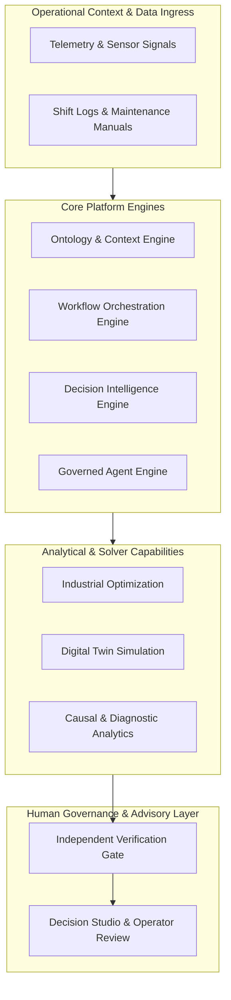

# QORVEXA — Industrial Decision Intelligence Platform
FactoryMind
> **From Industrial Complexity to Verified Operational Decisions.**

[](https://qorvexa-delta.vercel.app)
[](LICENSE)
[](#6-current-project-status)
[](https://www.python.org/)
[](https://www.typescriptlang.org/)

---

## 1. Project Introduction

**QORVEXA** is an industrial decision intelligence platform designed to help engineering and operations teams understand complex plant challenges, evaluate operational evidence, explore mathematical optimization and simulation, and make confident, verified operational decisions through intelligent, human-governed software.

Originally founded as the FactoryMind Cognitive Digital Twin research initiative, the project has evolved into QORVEXA—an integrated decision platform combining contextual intelligence, mathematical rigor, and strict operational governance.

## 2. The Industrial Problem

Industrial facilities face high-stakes operational trade-offs across maintenance schedules, equipment health, production bottlenecks, and energy costs:
- **Pure Generative AI** lacks mathematical grounding, cannot guarantee hard operational constraints, and risks hallucinating critical parameters.
- **Traditional Operations Research & Simulation** are mathematically sound but rigid, requiring extensive manual modeling and remaining disconnected from unstructured maintenance manuals, shift reports, and contextual engineering knowledge.

## 3. What QORVEXA Aims to Provide

QORVEXA unifies contextual understanding with verifiable mathematical methods:
- **Contextual Understanding:** Translates shift logs, operator notes, and operational telemetry into structured problems.
- **Mathematical Grounding:** Solves optimization and simulation models using dedicated computational engines.
- **Independent Verification:** Validates candidate solutions against physical bounds and constraints before presentation.
- **Human Governance:** Keeps all decisions under human review, approval, and auditability.

## 4. High-Level Capabilities

- **Evidence-Grounded Diagnosis:** Synthesizes telemetry anomalies, maintenance history, and engineering context into clear diagnostic hypotheses.
- **Advanced Industrial Optimization:** Evaluates operational trade-offs across production planning, capacity constraints, and maintenance timing.
- **Digital Twin Simulation:** Simulates operational scenarios to assess asset behavior under prospective decisions without plant disruption.
- **Decision Intelligence Studio:** Delivers structured, explainable decision briefs with explicit trade-off analyses and confidence assessments.
- **Human Review & Auditability:** Maintains a transparent, audit-ready chain of evidence for every recommended decision.

## 5. High-Level Architecture

QORVEXA organizes platform intelligence across four core platform engines:



- **Ontology & Context Engine:** Maps industrial telemetry, asset structures, and operating regimes into a unified domain model.
- **Workflow Orchestration Engine:** Coordinates multi-stage analytical pipelines from signal intake to decision delivery.
- **Decision Intelligence Engine:** Synthesizes solver outputs, trade-off curves, and simulation results into actionable advisory briefs.
- **Governed Agent Engine:** Provides controlled, assistive AI workflows bounded by strict operating policies.

## 6. Current Project Status

- **Stage:** Active research and development (R&D).
- **Implementation:** Core analytical, optimization, and contextual modules have been implemented and verified in automated testing environments.
- **Field Status:** QORVEXA is a prototype and has **not** been deployed in a live industrial production facility.
- **Connectivity:** Live industrial connectivity (e.g., OPC-UA, MQTT, or live SCADA links) is under development and is not currently active; metrics derive from public benchmark datasets and validation suites.
- **Advisory Role:** The platform is purely decision-support software and does not actuate equipment.

## 7. Industrial Safety Principles

1. **Advisory & Read-Only:** QORVEXA never writes to Programmable Logic Controllers (PLCs), never adjusts machine setpoints, and never actuates equipment.
2. **Human in the Loop:** Every insight, recommendation, or optimization result requires human engineer validation and sign-off.
3. **Epistemic Honesty:** The platform strictly separates measured telemetry facts from mathematical proofs, simulation estimates, and subjective assumptions.

## 8. First Use-Case Direction

QORVEXA's initial application focuses on **Air Production Units (APUs) and compressor systems**, addressing early leak detection, duty-cycle anomalies, and operational maintenance planning. Validation uses established benchmark datasets, including the public [MetroPT-3 dataset](https://archive.ics.uci.edu/dataset/791/metropt+3+dataset) and [AI4I 2020 dataset](https://archive.ics.uci.edu/dataset/601/ai4i+2020+predictive+maintenance+dataset).

## 9. Technology Stack

- **Core Backend:** Python 3.12, FastAPI, Pydantic, NumPy, SciPy.
- **Mathematical Optimization:** Dedicated Operations Research and linear programming solvers.
- **Frontend & Visualization:** React 19, TypeScript, Vite, Tailwind CSS.
- **Package Management:** [uv](https://docs.astral.sh/uv/) for high-speed, deterministic Python environments.

## 10. Live Demo & Resources

- **Interactive Showcase:** [qorvexa-delta.vercel.app](https://qorvexa-delta.vercel.app) — Explore the Decision Studio and scenario planning interface.
- **Repository Documentation:** Browse the [Documentation Guide](docs/README.md) for public developer onboarding, getting-started steps, and project overview.

## 11. Repository Structure

```
├── backend/       # Python core services, optimization modules, and API endpoints
├── frontend/      # React + TypeScript Decision Intelligence interface
├── docs/          # Research documentation, use-case specifications, and references
└── .github/       # CI/CD workflows and repository governance templates
```

## 12. Team

- **Mohamed Osama** — Technical Lead & Core Intelligence Architect
- **Ahmed Essam** — Advanced RAG & Retrieval Engineering
- **Mohamed Adel Ramadan** — Advanced Optimization Engineering
- **Beshoy Saad** — Causal Intelligence & Industrial Analytics
- **Ziad Ahmed** — Multi-Agent Orchestration & Governance
- **Ali Motassem** — Digital Twin, Simulation & Industrial Integration
