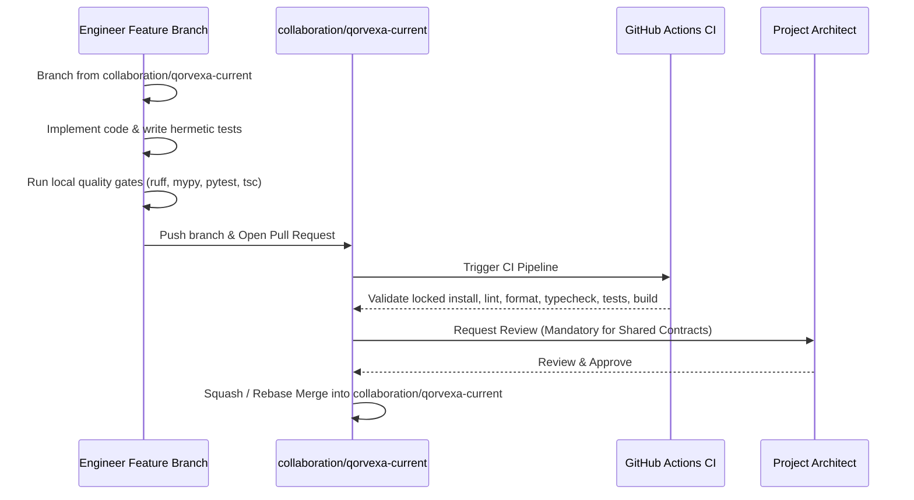

# QORVEXA — Development Workflow & Engineering Standards

**Document Status:** Official Team Engineering Specification  
**Effective Date:** November 23, 2026  
**Audience:** Five-Person Engineering Team (Mohamed Osama, Ahmed Essam, and Team Members 2, 4, 5)

---

## 1. Repository Architecture & Layout

```
QORVEXA/
├── .github/
│   ├── CODEOWNERS             # Initial architect review assignments
│   └── workflows/
│       └── ci.yml             # SHA-pinned CI pipeline (backend + frontend)
├── backend/
│   ├── src/qorvexa/           # Core Python package
│   │   ├── api/               # FastAPI industrial REST API & routes
│   │   ├── auth/              # Security boundary, token validation, RBAC
│   │   ├── connectors/        # Advisory OT/edge descriptors & attestation
│   │   ├── industrial/
│   │   │   ├── co_orchestration/  # Optimization–Simulation Co-Orchestration (OSCO)
│   │   │   ├── decision_intelligence/ # Pareto frontier & decision briefs
│   │   │   ├── digital_twin/      # Discrete-Event Simulation engine (DES)
│   │   │   ├── formulation/       # Canonical LP compiler & fact mapping
│   │   │   ├── governance/        # Fact Ledger & SQLite WAL persistence
│   │   │   ├── ontology/          # Factory entity resolution & knowledge graph
│   │   │   ├── understanding/     # Egyptian Arabic & industrial language engine
│   │   │   └── units/             # Dimensional units verification engine
│   │   ├── knowledge/         # Hybrid BM25 + dense vector retrieval
│   │   └── solver_fabric/     # Isolated HiGHS solver worker & verifier
│   ├── tests/                 # 1,924 hermetic backend tests
│   ├── pyproject.toml         # Locked dependencies & project metadata
│   └── uv.lock                # Deterministic dependency lockfile
├── frontend/
│   ├── src/
│   │   ├── api/               # Orval auto-generated client & planning API
│   │   ├── features/
│   │   │   ├── planning/      # Production Planning & Decision Studio
│   │   │   ├── solver/        # Formulation wizard & execution telemetry
│   │   │   └── twin/          # Digital Twin simulation workbench
│   │   └── routes/            # TanStack Router page layouts
│   ├── package.json           # React 19, TypeScript 5.7, Tailwind CSS v4, Vite 8
│   └── package-lock.json      # Deterministic frontend lockfile
├── docs/qorvexa/              # Architectural specs, onboarding, and status
├── CONTRIBUTING.md            # Team contribution & PR guidelines
├── SECURITY.md                # Vulnerability disclosure & OT safety policy
├── LICENSE                    # Proprietary commercial license
└── .env.example               # Reference environment configuration
```

---

## 2. Daily Engineering Lifecycle



---

## 3. Branching & Commit Conventions

### Branch Strategy
- **`collaboration/qorvexa-current`:** Day-to-day integration branch for the 5-person team.
- **`main`:** Customer release branch. Never target PRs to `main` directly during active development cycles.
- **Feature Branches:** Always name branches using standard prefixes:
  - `feat/<author>/<short-description>` (e.g., `feat/ahmed/hybrid-reranker`)
  - `fix/<author>/<short-description>` (e.g., `fix/user/highs-worker-timeout`)
  - `test/<author>/<short-description>` (e.g., `test/user/osco-stress-suite`)
  - `docs/<author>/<short-description>` (e.g., `docs/user/causal-graphs-spec`)

### Commit Messages
Use Conventional Commits:
```
feat(solver): add CP-SAT constraint programming worker adapter
fix(units): correct compound dimension parsing for specific energy
docs(onboarding): update tested Python and Node versions
chore(deps): update locked dependencies in uv.lock
```

---

## 4. Shared Contract Control Policy

The spine of QORVEXA relies on exact contract compatibility across multiple engines.

### Absolute Rule
**No two engineers should independently modify the same shared module or schema without explicit prior coordination.**

### Architect Review Required
Changes to the following modules require explicit review and sign-off from **Mohamed Osama** (Project Architect):
- `backend/src/qorvexa/solver_fabric/worker_contract.py`
- `backend/src/qorvexa/solver_fabric/canonical_lp.py`
- `backend/src/qorvexa/industrial/units/contracts.py`
- `backend/src/qorvexa/industrial/governance/store.py`
- `backend/src/qorvexa/industrial/ontology/contracts.py`
- `backend/src/qorvexa/industrial/co_orchestration/contracts.py`
- `backend/src/qorvexa/api/industrial.py`
- Advanced GraphRAG and agentic retrieval routing

---

## 5. Local Quality Gates (Pre-PR Verification)

Never open a PR claiming tests passed without running them locally.

### Backend Verification
```bash
cd backend

# Step 1: Linting
uv run ruff check .

# Step 2: Formatting Check
uv run ruff format --check .

# Step 3: Type Checking
uv run mypy src/qorvexa/

# Step 4: Full Hermetic Tests (Use dedicated basetemp)
uv run pytest --basetemp=../tmp_pytest -q
```

### Frontend Verification
```bash
cd frontend

# Step 1: Regenerate API client (if backend OpenAPI changed)
npm run generate:api
git diff --exit-code -- src/api/generated

# Step 2: Type Checking
npm run typecheck

# Step 3: Vitest Tests
npm test

# Step 4: Production Build
npm run build
```

---

## 6. Dependency Management Rules

1. **Backend Dependencies:**
   - Always install via `uv add <package>` or edit `pyproject.toml` and run `uv lock`.
   - Never use global `pip install`.
   - Pinned dependencies and hashes must be committed to `backend/uv.lock`.
2. **Frontend Dependencies:**
   - Always install via `npm install <package>`.
   - Committed changes must include `frontend/package-lock.json`.
3. **Adding Dependencies:**
   - New external dependencies must be justified in the PR description (license, security, maintenance activity).
   - Copyleft libraries (GPL, AGPL) are strictly prohibited.

---

## 7. Database & Local State Management

1. **Storage Engine:** QORVEXA uses SQLite with Write-Ahead Logging (WAL) for local session persistence and Fact Ledgers.
2. **Data Directory:** Local databases and artifacts reside outside the Git repository in the location specified by `QORVEXA_DATA_DIR` (defaults to `D:/QORVEXA/data` or `./data`).
3. **Idempotence & Cleanup:** Tests must never write to production databases; tests utilize isolated temporary directories (`tmp_path` or `--basetemp`).
