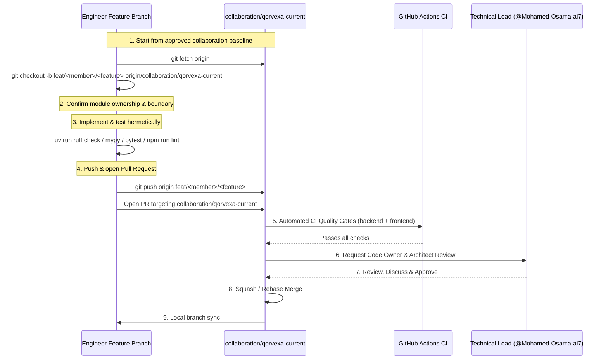

# QORVEXA — Development Workflow & Engineering Standards

**Document Status:** Official Team Engineering & Collaboration Specification  
**Effective Date:** November 23, 2026  
**Audience:** Six-Person Engineering Team (Mohamed Osama, Ahmed Essam, Mohamed Adel, Beshoy, Ziad, Ali Motassem)

---

## 1. Repository Architecture & Layout

```
QORVEXA/
├── .github/
│   ├── CODEOWNERS             # Review assignments based on verified GitHub handles
│   ├── pull_request_template.md # Standard PR submission template
│   ├── ISSUE_TEMPLATE/        # Bug, feature, and research investigation forms
│   └── workflows/
│       └── ci.yml             # SHA-pinned CI pipeline (owned by Member 6)
├── backend/
│   ├── src/qorvexa/           # Core Python package
│   │   ├── anomaly/           # Anomaly detection & calibration (Member 4)
│   │   ├── api/               # FastAPI REST endpoints & routes (Member 1)
│   │   ├── assets/            # Asset digital passport & sensor envelopes
│   │   ├── auth/              # Security boundary, token validation, RBAC (Member 1)
│   │   ├── causal/            # Structural Causal Models & RCA (Member 4)
│   │   ├── connectors/        # Advisory OT/edge descriptors (Member 6)
│   │   ├── contracts/         # Shared architectural interfaces (Member 1)
│   │   ├── copilot/           # Industrial copilot execution & guardrails (Member 5)
│   │   ├── industrial/
│   │   │   ├── co_orchestration/  # Optimization–Simulation Co-Orchestration (OSCO)
│   │   │   ├── decision_intelligence/ # Pareto frontier & briefs (Member 1)
│   │   │   ├── digital_twin/      # Discrete-Event Simulation engine (Member 6)
│   │   │   ├── formulation/       # Canonical LP compiler & models (Member 3)
│   │   │   ├── governance/        # Fact Ledger & SQLite WAL persistence (Member 1)
│   │   │   ├── ontology/          # Factory entity resolution & knowledge graph (Member 1)
│   │   │   ├── production_planning/ # Planning workflows (Member 3)
│   │   │   ├── understanding/     # Egyptian Arabic & industrial language engine (Member 1)
│   │   │   └── units/             # Dimensional units verification engine (Member 1)
│   │   ├── knowledge/         # Hybrid BM25 + dense retrieval & ingestion (Member 2)
│   │   ├── ml/                # Multi-model ML & degradation models (Member 4)
│   │   └── solver_fabric/     # Isolated HiGHS solver worker & verifier (Member 1)
│   ├── tests/                 # 1,924 hermetic backend tests
│   ├── pyproject.toml         # Locked dependencies & project metadata
│   └── uv.lock                # Deterministic dependency lockfile
├── frontend/
│   ├── src/
│   │   ├── api/               # Orval auto-generated client & planning API
│   │   ├── features/
│   │   │   ├── anomaly/       # Anomaly replay & monitoring (Member 4)
│   │   │   ├── assets/        # Asset digital passport viewer
│   │   │   ├── audit/         # Fact ledger & audit viewer (Member 1/5)
│   │   │   ├── copilot/       # Copilot UI & grounding cards (Member 5)
│   │   │   ├── edge/          # OT edge connectors workspace (Member 6)
│   │   │   ├── incidents/     # Incident RCA & evidence packages (Member 4)
│   │   │   ├── knowledge/     # Knowledge explorer & hybrid RAG UI (Member 2)
│   │   │   ├── ml/            # Model cards & calibration probes (Member 4)
│   │   │   ├── planning/      # Production Planning & Studio (Member 3)
│   │   │   ├── solver/        # Formulation wizard & execution telemetry (Member 1/3)
│   │   │   ├── system/        # System status & observability (Member 6)
│   │   │   └── twin/          # Digital Twin simulation workbench (Member 6)
│   │   └── routes/            # TanStack Router page layouts
│   ├── package.json           # React 19, TypeScript 5.7, Tailwind CSS v4, Vite 8
│   └── package-lock.json      # Deterministic frontend lockfile
├── docs/qorvexa/              # Architectural specs, onboarding, and status
├── CONTRIBUTING.md            # Team contribution & PR guidelines
├── SECURITY.md                # Vulnerability disclosure & OT safety policy
├── LICENSE                    # Proprietary commercial license
└── .env.example               # Reference environment configuration
```

---

## 2. Nine-Step Git Collaboration Lifecycle

To coordinate six engineers working on interdependent subsystems without code collision:



### The 9 Steps Explained

1. **Start from the Baseline:** Always branch from the latest approved collaboration baseline on `collaboration/qorvexa-current`. Never branch off an unmerged personal branch unless explicitly coordinating a stacked PR.
2. **Create a Dedicated Branch:** Use conventional branch names:
   - `feat/<author>/<short-description>` (e.g., `feat/ahmed/sparse-reranker`, `feat/adel/cpsat-scheduling`)
   - `fix/<author>/<short-description>` (e.g., `fix/beshoy/degradation-curve-nan`)
   - `research/<author>/<short-description>` (e.g., `research/ziad/agent-timeout-recovery`)
   - `test/<author>/<short-description>` (e.g., `test/ali/osco-stress-bench`)
   - `docs/<author>/<short-description>` (e.g., `docs/mohamed/ampps-adr`)
3. **Confirm Module Ownership:** Check [TEAM_WORKSTREAMS.md](TEAM_WORKSTREAMS.md) to confirm that the files you intend to touch fall within your workstream.
4. **Avoid Cross-Workstream Edits:** Never edit files belonging to another member's active workstream without prior alignment in daily async sync.
5. **Implement & Test Locally:** Write hermetic unit and integration tests covering all new logic. Run full local linting, formatting, and type checks.
6. **Submit a Pull Request:** Use the official Pull Request template (`.github/pull_request_template.md`). Fill out all sections honestly, including test pass counts.
7. **Provide Test Evidence:** Attach exact test outputs, benchmarks, and log excerpts.
8. **Resolve Review Feedback:** Address reviewer comments promptly. Re-verify locally after applying suggestions.
9. **Merge via Approved Process:** Merging into `collaboration/qorvexa-current` requires passing CI status checks and approval from the assigned module owner (and Technical Lead Mohamed Osama for any shared contracts).

---

## 3. Pull Request & Review Policy

### Review Turnaround
- PRs should receive initial review within **24 to 48 business hours**.
- If a PR blocks another team member's active workstream, tag the reviewer as `urgent-blocker` in team chat.

### Approval Rules
- **Standard PR:** Requires approval from at least 1 designated code owner.
- **Shared Contract PR:** Any PR modifying files in `backend/src/qorvexa/contracts/`, `backend/src/qorvexa/api/`, `backend/src/qorvexa/solver_fabric/`, or database migrations **requires mandatory approval from Technical Lead Mohamed Osama (`@Mohamed-Osama-ai7`)**.
- **CI/CD Pipeline PR:** Any PR modifying `.github/workflows/` **requires approval from Member 6 (Ali Motassem)**.

### Conflict Resolution Protocol
1. **Interface Disputes:** If two members disagree on an interface definition or data contract, Technical Lead Mohamed Osama has final decision authority based on mathematical correctness and system simplicity.
2. **Git Merge Conflicts:** Rebase your feature branch on `origin/collaboration/qorvexa-current` (`git pull --rebase origin collaboration/qorvexa-current`). Never resolve conflicts by overwriting another member's verified tests or logic.

---

## 4. Local Quality Gates (Pre-PR Checklist)

### Backend Quality Gates
```bash
cd backend

# 1. Linting (Zero errors required)
uv run ruff check .

# 2. Formatting Check (Zero modifications needed)
uv run ruff format --check .

# 3. Static Type Analysis (Zero errors in source files)
uv run mypy src/qorvexa/

# 4. Evaluation Benchmark Audit
uv run python -m qorvexa.evaluation audit --strict

# 5. Full Hermetic Test Suite
uv run pytest --basetemp=../tmp_pytest -q
```

### Frontend Quality Gates
```bash
cd frontend

# 1. Biome Linter (Zero errors required)
npm run lint

# 2. TypeScript Static Typecheck
npm run typecheck

# 3. Vitest Component & Unit Tests
npm test -- --fileParallelism=false --maxWorkers=1

# 4. Production Build Verification
npm run build
```
