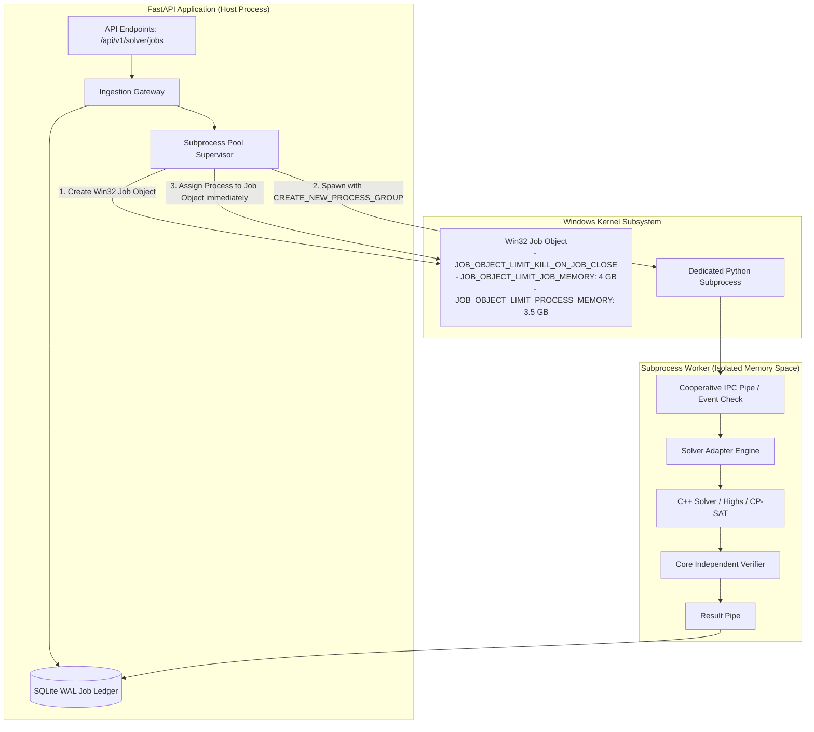

# QORVEXA Canonical Architectural & API Contract: Research Lab to Core Solver Fabric

**Document Status:** Final Canonical Architecture Specification & Contract Definition  
**Version:** 1.3.0-CANONICAL-FINAL  
**Date:** 2026-11-21  
**Authors:** Architecture & Core Systems Engineering  
**Repositories:**
- Core: `D:\QORVEXA\FactoryMind-CDT` (`feat/qorvexa-eval-harness`)
- Research Lab: `D:\QORVEXA-Research-Lab` (`standalone`)

---

## Executive Summary & Non-Negotiable Epistemic Principles

This specification defines the canonical, technology-independent contract between the **Google AI Studio Research Lab** (AI-assisted problem intake, evidence extraction, human clarification, and problem formulation) and the **QORVEXA Core Solver Fabric** (validation, capability matching, deterministic execution, independent verification, and governed decision support).

### The Five Epistemic Laws of QORVEXA:
1. **Separation of Cognitive and Numerical Labor:** LLMs formulate hypotheses; Solvers compute numbers; Independent Verifiers certify solutions; Humans govern operational decisions.
2. **Immutability of Formulation Unverified State:** `mathematicallyVerified: false` is an immutable constant during AI formulation. Under no circumstances may an LLM, prompt instruction, or heuristic agent set `mathematicallyVerified: true`.
3. **Solution Certification $\ne$ Model Correctness:** Mathematically proving that a candidate solution vector $x^*$ satisfies or optimizes an optimization model $\mathcal{M}$ does **NOT** prove that $\mathcal{M}$ accurately represents the physical plant. Model fidelity is an empirical engineering responsibility grounded in validated physical evidence.
4. **Adaptive Multi-Family Solver Routing:** The Core Solver Fabric is an adaptive routing dispatcher across specialized mathematical and physical solver families (MILP, LP, CP-SAT, NLP, Physics ODE Twin, Multi-Criteria Pareto, Diagnostic RCA), rather than forcing every industrial problem through an optimization matrix.
5. **Zero-Trust Solver Verification:** A solver's self-reported exit code (e.g. `OPTIMAL`) is **never** accepted as truth. Feasibility and optimality must be independently audited by a decoupled verification engine using double-precision IEEE 754 arithmetic and dimension-aware scaled tolerances.

---

## 0. Baseline Verification & Option A Preservation

The Core environment recovery completed in Option A has been verified as preserved and functional:

1. **Active Configuration:**
   - [backend/src/factorymind/config.py](file:///D:/QORVEXA/FactoryMind-CDT/backend/src/factorymind/config.py#L24-L27): `data_dir = D:/QORVEXA/data`, `artifacts_dir = D:/QORVEXA/artifacts`.
   - [backend/.env](file:///D:/QORVEXA/FactoryMind-CDT/backend/.env#L2-L10): Verified pointing to `sqlite:///D:/QORVEXA/data/factorymind-demo.sqlite3`.
   - [backend/src/factorymind/evaluation/\__main\__.py](file:///D:/QORVEXA/FactoryMind-CDT/backend/src/factorymind/evaluation/__main__.py#L450): CLI `--data-dir` default points to `D:/QORVEXA/data`.
   - [.env.example](file:///D:/QORVEXA/FactoryMind-CDT/.env.example#L4-L23): Clean template references.
2. **Repository Integrity:**
   - Backend test suite: **797 passed / 0 failed (100% pass rate)**.
   - Static analysis: `ruff` and `mypy` strict pass with 0 errors across 89 source modules.
   - Worktree: `qorvexa-deploy/.git` points cleanly to active Core repository.
   - Drive `D:` Junctions: `D:\FactoryMind\FactoryMind-CDT`, `D:\FactoryMind\data`, `D:\FactoryMind\artifacts` remain in place to safeguard binary launcher paths and historical references in air-gapped environments without package re-installation.

---

## 1. The Four-Tier Validation & Verification Architecture

Verification is strictly partitioned into four sequential tiers:

```
[Problem Intake & AI-Assisted Formulation]
                     │
                     ▼
       [Tier 1: Schema Validation]
       Structural typing, field presence, bounds sanity (l <= u).
                     │
                     ▼
   [Tier 2: Mathematical Model Validation]
   Dimensional homogeneity, unit coherence, non-empty feasibility space,
   disjoint operator check. (Formulation remains: mathematicallyVerified: false)
                     │
                     ▼
         [Adaptive Solver Routing]
   (HiGHS MILP, OR-Tools CP-SAT, Physics ODE Twin, SLSQP/IPOPT, RCA Engine)
                     │
                     ▼
    [Tier 3: Solution Feasibility Verification]
    Independent re-evaluation of all constraints g_i(x*) on raw IEEE 754 float64.
    Evaluated with dimension-aware and scale-dependent residuals.
                     │
                     ▼
    [Tier 4: Solution Optimality Verification]
    Evaluated by mathematical family: dual certificates, branch-and-bound bounds,
    integrality gap, or first-order KKT stationarity (for continuous NLP).
                     │
                     ▼
       [Human Engineering Governance]
       Review certified mathematical results against physical plant assumptions.
```

### 1.1 Verification Methods by Mathematical Problem Family

Universal mathematical criteria (such as Karush-Kuhn-Tucker / KKT conditions) **cannot** be applied across all solver types. Discrete and integer constraints lack gradients and constraint qualifications. The Core Independent Verifier applies specialized mathematical verification routines:

```mermaid
flowchart TD
    Prob[Candidate Solution x*] --> Router{Problem Family?}
    
    Router -->|MILP / LP| V_MILP[MILP Verifier]
    Router -->|CP-SAT| V_CP[CP-SAT Verifier]
    Router -->|Continuous NLP| V_NLP[NLP KKT Verifier]
    Router -->|Physics ODE Twin| V_ODE[ODE Integrator Verifier]
    Router -->|Diagnostic RCA| V_RCA[Evidence Consistency Verifier]
    
    V_MILP --> M1[Check Integrality: |x_j - round| <= eps_int]
    M1 --> M2[Check Dimension-Scaled Residuals: A x <= b]
    M2 --> M3[Check Dual Certificate / LP Node Relaxation Gap]
    
    V_CP --> C1[Check Integer Feasibility & Table Constraints]
    C1 --> C2[Verify Disjunctive / Cumulative Schedule Windows]
    C2 --> C3[Audit Solver-Reported Optimality Claim vs Best Bound]
    
    V_NLP --> N1[Check Scaled Nonlinear Residuals: g_i(x) <= 0]
    N1 --> N2[Evaluate KKT Stationarity: ||grad f + sum lambda grad g||]
    N2 --> N3[Check Absolute Complementarity: |lambda_i * g_i(x)| <= eps_comp]
    N3 --> N4[Verify Constraint Qualification: LICQ / MFCQ status]
    N4 --> N5[Certify strictly as FIRST_ORDER_KKT_POINT]
    
    V_ODE --> O1[Higher-Order Adaptive Integration Residual]
    O1 --> O2[Physical Conservation: Mass & Energy Invariants]
    O2 --> O3[Separate Calibration from Out-of-Sample Validation]
    
    V_RCA --> R1[Deterministic Support Score Recomputation]
    R1 --> R2[Contradiction & Evidence Package Audit]
```

#### Family-Specific Verification Table

| Problem Family | Primal Feasibility Verification | Optimality / Certification Verification | Evidence Required for Certification |
|:---|:---|:---|:---|
| **MILP** | 1. Integrality: $|x_j^* - \text{round}(x_j^*)| \le \epsilon_{\text{int}}$ ($10^{-9}$)<br>2. Dimension-scaled linear residuals: $\frac{\max(0, a_i^T x^* - b_i)}{s_i^{\text{con}}} \le \epsilon_{\text{feas}}^{\text{rel}}$ | Dual Bound Verification: Compare primal objective $c^T x^*$ with validated branch-and-bound dual bound $z_{\text{dual}}$. Dual gap $\le \epsilon_{\text{opt}}$. | Primal vector $x^*$, validated dual bound $z_{\text{dual}}$, node count, SHA-256 certificate. |
| **Continuous LP** | Dimension-scaled linear residuals: $\frac{\|A x^* - b\|}{s^{\text{con}}} \le \epsilon_{\text{feas}}^{\text{rel}}$, $l \le x^* \le u$. | Dual Simplex Certificate: Compute dual vector $y^*$. Verify dual feasibility $A^T y^* \le c$ and zero duality gap $c^T x^* - b^T y^* \le \epsilon_{\text{opt}}$. | Primal vector $x^*$, dual multipliers $y^*$, basic variable basis status array. |
| **CP-SAT** | Direct integer propagator check: evaluates all boolean logic, linear integer constraints, `all_different`, and `cumulative` resource intervals independently. | **Solver-Reported Optimality Claim:** In public CP-SAT APIs, SAT conflict proofs (DRAT/LRAT) are internal. Core audits the solver-reported dual bound $z_{\text{best\_bound}}$ and relative gap. Distinguishes `PROVEN_OPTIMAL` (gap = 0) from `OPTIMAL_WITHIN_GAP` ($\text{gap} \le \epsilon_{\text{opt}}$). | Assignment map, solver-reported best bound, conflict count. Marked explicitly as `isIndependentlyVerifiable: false`. |
| **Continuous NLP** | Scaled nonlinear residuals: $\frac{\max(0, g_i(x^*))}{s_i^{\text{con}}} \le \epsilon_{\text{feas}}^{\text{rel}}$, $\frac{\|h_j(x^*)\|}{s_j^{\text{con}}} \le \epsilon_{\text{feas}}^{\text{rel}}$. | First-Order KKT Stationarity: Check $\|\nabla f(x^*) + \sum \lambda_i \nabla g_i(x^*) + \sum \mu_j \nabla h_j(x^*)\|_\infty \le \epsilon_{\text{kkt}}$, $\lambda_i \ge 0$.<br>Absolute Complementarity: $|\lambda_i \cdot g_i(x^*)| \le \epsilon_{\text{comp}}$.<br>Constraint Qualification: Records whether LICQ or MFCQ holds.<br>*CRITICAL:* Certified strictly as **FIRST_ORDER_KKT_POINT** (KKT is not sufficient for optimality unless convex). | Primal vector $x^*$, Lagrange multipliers $(\lambda, \mu)$, projected gradient norm, constraint qualification status. |
| **Physics Digital Twin (ODE)** | Numerical Integration Consistency: Re-integrates system using 8th-order Dormand-Prince (DOP853) with tighter step-size tolerances ($10^{-9}$); confirms trajectory drift $\le \epsilon_{\text{ode}}$. | Physical Invariant Conservation: Verifies mass balance (mass inflow = mass outflow + accumulation) and thermal equilibrium over the simulated window. | Complete state trajectory array, mass balance residual, thermal conservation residual. |
| **Diagnostic RCA** | Recomputes evidence consistency scores deterministically from raw `EventEvidencePackage`. | Contradiction Disproval: Confirms that ruled-out hypotheses have explicitly identified contradicting citations. | Hypothesis support scores, contradiction audit log, evidence ref list. |

### 1.2 Dimension-Aware Scaled Residuals

Universal scaling assumptions such as $\max(1.0, |b_i|)$ are rejected because physical units vary over many orders of magnitude (e.g. pressure in $\text{Pa} \sim 10^5$ vs $\text{bar} \sim 1$, clearance in $\text{mm} \sim 10^{-3} \text{ m}$).

The Core Independent Verifier defines per-constraint dimension-aware scaling:
$$s_i^{\text{con}} = \max\left(s_{\text{unit}, i}, |b_i|, \sum_{j} |a_{ij}| s_j^{\text{var}}\right)$$
where:
- $s_{\text{unit}, i}$ is the characteristic physical scale derived from unit metadata (e.g., $10^5 \text{ Pa}$ for pressure, $1.0 \text{ m}^3/\text{h}$ for flow rate, $1.0 \text{ kW}$ for power, $0.01 \text{ m}$ for displacement).
- $s_j^{\text{var}}$ is the characteristic variable scale (defaulting to $\max(s_{\text{unit}, j}, |u_j - l_j|)$).

A constraint is certified **Feasible** if and only if:
$$|g_i(x^*)| \le \epsilon_{\text{abs}, i} + \epsilon_{\text{rel}, i} \cdot s_i^{\text{con}}$$
where $\epsilon_{\text{abs}, i}$ and $\epsilon_{\text{rel}, i}$ are explicitly configured per constraint (defaulting to $\epsilon_{\text{rel}} = 10^{-6}, \epsilon_{\text{abs}} = 10^{-6} \cdot s_{\text{unit}}$).

### 1.3 Infeasibility Evidence: Verifiable Certificates vs Solver Claims

Infeasibility handling depends strictly on solver capability:
- **Farkas Certificate (Independently Verifiable):** Available for LP and continuous convex optimization. Core independently evaluates $A^T y \ge 0$ and $b^T y < 0$ with $y \ge 0$.
- **Irreducible Infeasible Subsystem (IIS) (Solver-Reported or Verifiable by Re-Solve):** Available for MILP (HiGHS, SCIP, Gurobi) and CP-SAT. Core reports the minimal conflicting constraint set $\{C_{k_1}, \dots, C_{k_m}\}$. Verifiable by confirming that any $m-1$ subset is feasible while the full $m$ set is infeasible.
- **Solver-Reported Infeasibility (Heuristic / Unverified):** For nonlinear local solvers that terminate with no feasible point found, the status is strictly recorded as `LOCALLY_INFEASIBLE` with `isIndependentlyVerifiable: false`.

### 1.4 Digital Twin: Separation of Numerical, Physical, and Empirical Tiers

The Physics Digital Twin verification separates:
1. **Numerical Integration Consistency:** Evaluates truncation error and step-size stability of numerical ODE solvers.
2. **Conservation Checks:** Evaluates first-principles physical laws (conservation of mass, momentum, and energy) independently of telemetry.
3. **Physical Model Validation:** Evaluates held-out out-of-sample predictive accuracy against historical telemetry benchmarks (e.g. MetroPT-3 trajectory MAE).
4. **Empirical Calibration:** Evaluates parameter identifiability and sensitivity during model fitting on calibration sets.

---

## 2. Canonical Expression Architecture: Typed JSON `ExprNode`

Core defines the **Typed JSON `ExprNode`** schema to support linear, nonlinear, discrete, logical, physical, and statistical expressions.

### 2.1 Complete TypeScript Schema

```typescript
export type ExprNodeType =
  | 'literal'
  | 'variable_ref'
  | 'parameter_ref'
  | 'unary_op'
  | 'binary_op'
  | 'nary_op'
  | 'comparison'
  | 'lookup_table'
  | 'statistical_distribution'
  | 'uncompiled';

export type UnaryOperator = 'abs' | 'neg' | 'sqrt' | 'exp' | 'log' | 'sin' | 'cos' | 'not';
export type BinaryOperator = 'add' | 'sub' | 'mul' | 'div' | 'pow' | 'min' | 'max' | 'and' | 'or' | 'xor' | 'mod';
export type NaryOperator = 'sum' | 'prod' | 'all' | 'any' | 'piecewise_linear';
export type ComparisonOperator = '<=' | '>=' | '==' | '<' | '>' | '!=';

export interface Dimensionality {
  length?: number;      // L (meters)
  mass?: number;        // M (kilograms)
  time?: number;        // T (seconds)
  current?: number;     // I (amperes)
  temperature?: number; // Theta (kelvin)
  currency?: number;    // Currency units (EUR, USD)
  dimensionless?: boolean;
}

export type ExprNode =
  | {
      type: 'literal';
      dataType: 'real' | 'integer' | 'boolean' | 'string';
      value: number | boolean | string;
      unit?: string;
      dimension?: Dimensionality;
    }
  | {
      type: 'variable_ref';
      variableId: string;
      timeIndex?: number;
      unit?: string;
      dimension?: Dimensionality;
    }
  | {
      type: 'parameter_ref';
      parameterId: string;
      defaultValue?: number;
      unit?: string;
      dimension?: Dimensionality;
    }
  | {
      type: 'unary_op';
      operator: UnaryOperator;
      argument: ExprNode;
      dimension?: Dimensionality;
    }
  | {
      type: 'binary_op';
      operator: BinaryOperator;
      left: ExprNode;
      right: ExprNode;
      dimension?: Dimensionality;
    }
  | {
      type: 'nary_op';
      operator: NaryOperator;
      arguments: ExprNode[];
      dimension?: Dimensionality;
    }
  | {
      type: 'comparison';
      operator: ComparisonOperator;
      left: ExprNode;
      right: ExprNode;
    }
  | {
      type: 'lookup_table';
      curveId: string;
      input: ExprNode;
      interpolation: 'linear' | 'cubic_spline';
      unit?: string;
      dimension?: Dimensionality;
    }
  | {
      type: 'statistical_distribution';
      distribution: 'normal' | 'uniform' | 'triangular' | 'weibull';
      parameters: Record<string, number>;
      unit?: string;
      dimension?: Dimensionality;
    }
  | {
      type: 'uncompiled';
      expressionSummary: string;
    };
```

### 2.2 MathJSON Interoperability
The typed `ExprNode` architecture supports bidirectional, lossless conversion to and from the MathJSON standard (`mathjson.org`):
- `to_mathjson(node: ExprNode) -> list | dict | str | float`
- `from_mathjson(json_expr: Any) -> ExprNode`
MathJSON is utilized for external interchange and visual mathematical rendering, while `ExprNode` remains the internal, strictly-typed Pydantic contract.

---

## 3. Windows Execution Architecture (Python 3.12)

The Core backend operates on Windows with Python 3.12. In-process solver execution and POSIX signal models (`SIGINT` $\to$ `SIGKILL`) are **rejected**.

### 3.1 Windows Process Isolation Architecture



### 3.2 Technical Execution Rules for Windows (Python 3.12)
1. **Two-Stage Process Termination on Windows:**
   - **Primary (Cooperative IPC):** The supervisor sets a cancellation flag on the shared IPC pipe. The worker periodically polls the flag between branch-and-bound iterations or ODE integration steps.
   - **Secondary (Console Break):** If IPC is unacknowledged within 1.0s, the supervisor sends `signal.CTRL_BREAK_EVENT` via `proc.send_signal(signal.CTRL_BREAK_EVENT)` (caught via `signal.SIGBREAK` in Python).
   - **Tertiary (Hard Termination):** If the worker does not exit within 3.0s, the supervisor invokes `proc.terminate()` (`TerminateProcess`), unconditionally reclaiming memory.
2. **Win32 Job Objects (`kernel32.dll` via `ctypes`):**
   - **Immediate Assignment:** The supervisor creates the Job Object and invokes `AssignProcessToJobObject(hJob, proc._handle)` **immediately** after `subprocess.Popen` returns, before any solver tasks are dispatched.
   - **Aggregate vs Per-Process Memory Limits:**
     - `JOB_OBJECT_LIMIT_PROCESS_MEMORY`: Caps private bytes for each individual process (default: 3.5 GB).
     - `JOB_OBJECT_LIMIT_JOB_MEMORY`: Caps aggregate private bytes across the worker and any C++ solver helper processes/threads (default: 4.0 GB).
   - **Guaranteed Cleanup:** `JOB_OBJECT_LIMIT_KILL_ON_JOB_CLOSE` ensures that if the host FastAPI process crashes or is killed, Windows kernel immediately terminates all child solver processes.
3. **SQLite WAL Persistence & Startup Recovery:**
   - All job tables operate in `WAL` mode (`PRAGMA journal_mode=WAL; PRAGMA synchronous=NORMAL;`).
   - On startup, Core performs an automated orphan recovery sweep: any job marked `RUNNING` whose worker PID is not currently active in Windows tasklist is updated to `FAILED / PROCESS_ABORTED`.

---

## 4. Reconciled Canonical Contract: ProblemSpec v1.1.0

### 4.1 TypeScript Schema Definition

```typescript
export const PROBLEM_SPEC_SCHEMA_VERSION = '1.1.0' as const;

export interface DecisionVariableSpecV1_1 {
  id: string;
  name: string;
  symbol: string;
  domain: 'continuous' | 'integer' | 'binary' | 'semi_continuous' | 'semi_integer' | 'categorical' | 'discrete_set' | 'unknown';
  unit: string;
  dimensionality?: Dimensionality;
  nominalScale?: number; // Characteristic physical scale (e.g. 100.0)
  lowerBound: number | null;
  upperBound: number | null;
  discreteValues?: number[] | string[];
  initialValue?: number | null;
  description: string;
  epistemicStatus: 'extracted_fact' | 'assumption' | 'hypothesis';
  supportingEvidenceIds: string[];
}

export interface ObjectiveSpecV1_1 {
  id: string;
  direction: 'minimize' | 'maximize';
  name: string;
  expressionSummary: string;
  expressionAst?: ExprNode;
  unit: string;
  priorityOrder: number;
  weight?: number;
  absTolerance?: number;
  relTolerance?: number;
  epistemicStatus: 'extracted_fact' | 'assumption' | 'hypothesis';
  supportingEvidenceIds: string[];
}

export interface ConstraintSpecV1_1 {
  id: string;
  name: string;
  category: 'capacity' | 'safety' | 'balance' | 'regulatory' | 'operational' | 'temporal' | 'quality' | 'other';
  relation: '<=' | '>=' | '==' | 'range' | 'in_set' | 'sos1' | 'sos2' | 'logical';
  expressionSummary: string;
  expressionAst?: ExprNode;
  boundValue: number | null;
  upperBoundValue?: number | null;
  unit: string;
  nominalScale?: number; // Custom constraint scale s_i^con
  absTolerance?: number; // Default: 1e-6 * nominalScale
  relTolerance?: number; // Default: 1e-6
  hardness: 'hard' | 'soft' | 'unknown';
  penaltyWeight?: number;
  epistemicStatus: 'extracted_fact' | 'assumption' | 'hypothesis';
  supportingEvidenceIds: string[];
}

export interface ProblemSpecV1_1 {
  schemaVersion: typeof PROBLEM_SPEC_SCHEMA_VERSION | '1.0.0';
  problemId?: string;
  title: string;
  problemDescription: string;
  problemType:
    | 'linear_programming'
    | 'mixed_integer_linear_programming'
    | 'nonlinear_programming'
    | 'constraint_programming'
    | 'scheduling'
    | 'routing'
    | 'resource_allocation'
    | 'simulation_what_if'
    | 'root_cause_diagnostic'
    | 'unknown';
  formulationStatus:
    | 'Draft Ready for Solver Review'
    | 'Needs Clarification — Missing Information'
    | 'Insufficient Information';

  // IMMUTABLE EPISTEMIC GUARD: Always false in formulation
  mathematicallyVerified: false;

  timeHorizon: {
    isSpecified: boolean;
    duration: string | null;
    timeStep: string | null;
    unit: string | null;
    notes: string;
  };

  multiObjectiveStrategy?: 'single_objective' | 'weighted_sum' | 'lexicographic_hierarchical' | 'pareto_frontier_exploration';
  units: Array<{
    quantity: string;
    unit: string;
    dimensionality?: Dimensionality;
    source: 'extracted_fact' | 'assumption' | 'missing';
    evidenceRef: string;
  }>;

  decisionVariables: DecisionVariableSpecV1_1[];
  objectives: ObjectiveSpecV1_1[];
  constraints: ConstraintSpecV1_1[];

  extractedFacts: Array<{
    id: string;
    statement: string;
    sourceQuote: string;
    evidenceRef: string;
  }>;

  assumptions: Array<{
    id: string;
    statement: string;
    category: 'assumption' | 'hypothesis';
    rationale: string;
    impactIfFalse: string;
    requiresUserConfirmation: boolean;
  }>;

  missingInformation: Array<{
    id: string;
    field: string;
    questionForUser: string;
    severity: 'blocking' | 'important' | 'optional';
    whyRequiredForSolver: string;
  }>;

  uncertainties: Array<{
    id: string;
    parameterOrAspect: string;
    uncertaintyType: 'aleatoric_data' | 'epistemic_missing' | 'model_structure' | 'unit_ambiguity' | 'measurement_noise';
    description: string;
    mitigationOrDataNeeded: string;
  }>;

  supportingEvidence: Array<{
    evidenceId: string;
    sourceType: 'problem_statement' | 'Document' | 'Sensor CSV' | 'Multimodal' | 'Operator Note';
    excerpt: string;
    reliabilityNote: string;
  }>;

  clarificationQuestions: string[];
  solverHandoffNotes: {
    recommendedSolverFamily: string;
    readinessForMathematicalSolver: boolean;
    blockingGapsCount: number;
    epistemicBoundaryNotice: string;
    targetSolverId?: string;
    timeoutSeconds?: number;
    optimalityTolerance?: number;
  };
}
```

---

## 5. Result & Verification Contracts

The solver result decouples solver claims from independent mathematical certification:

### 5.1 Canonical Result Schema

```json
{
  "jobId": "job-8f2a1b9c-5e4d-4c3b-8a1e-7f6d5c4b3a21",
  "problemId": "prob-parallel-pump-dispatch",
  "schemaVersion": "1.1.0",
  "completedAt": "2026-11-21T23:45:01.910Z",
  "totalElapsedMilliseconds": 1940,
  
  "solverStatus": {
    "engine": "HiGHS v1.7.2",
    "terminationStatus": "SOLVER_CLAIMED_OPTIMAL",
    "terminationReason": "OPTIMAL_SOLUTION_FOUND",
    "solveTimeWallSeconds": 1.284,
    "solveTimeCpuSeconds": 2.451,
    "iterationsCount": 382,
    "branchAndBoundNodes": 42
  },
  
  "candidateSolution": {
    "status": "FEASIBLE_CANDIDATE_PRESENT",
    "objectiveValues": [
      {
        "id": "OBJ-01",
        "direction": "minimize",
        "value": 42.184,
        "unit": "EUR"
      }
    ],
    "variableAssignments": [
      {
        "variableId": "VAR-01",
        "symbol": "q_1",
        "value": 85.4,
        "unit": "m3/h",
        "reducedCost": 0.0
      },
      {
        "variableId": "VAR-02",
        "symbol": "u_1",
        "value": 1.0,
        "unit": "dimensionless",
        "reducedCost": -12.4
      }
    ]
  },
  
  "feasibilityVerification": {
    "verified": true,
    "status": "VERIFIED_FEASIBLE",
    "maxAbsoluteResidual": 0.0,
    "maxScaledResidual": 0.0,
    "scaledResidualToleranceUsed": 1e-6,
    "violatedConstraintsCount": 0,
    "worstViolatedConstraintId": null,
    "constraintEvaluations": [
      {
        "constraintId": "CON-01",
        "lhsValue": 85.4,
        "relation": ">=",
        "rhsValue": 38.0,
        "slack": 47.4,
        "scaledResidual": 0.0,
        "isViolated": false,
        "isBinding": false
      }
    ]
  },
  
  "optimalityVerification": {
    "verified": true,
    "status": "CERTIFIED_OPTIMAL",
    "primalObjective": 42.184,
    "dualBound": 42.184,
    "absoluteGap": 0.0,
    "relativeGap": 0.0,
    "optimalityToleranceUsed": 1e-4,
    "verificationFamily": "MILP_DUAL_BOUND_CHECK",
    "isIndependentlyVerifiable": true
  },
  
  "infeasibilityEvidence": null,
  
  "verificationCertificate": {
    "certificateId": "CERT-20261121-8F2A1B",
    "verifierEngine": "Core Independent Residual Checker v1.3.0",
    "certificateSha256": "d8a291f07b1c4e9f3b2a18e9c7d6e5a4b3c2d1e0f9a8b7c6d5e4f3a2b1c0d9e8",
    "verifiedAt": "2026-11-21T23:45:01.910Z"
  },
  
  "numericalWarnings": [],
  "failureDetails": null,
  
  "governanceReview": {
    "humanApprovalRequired": true,
    "approvalReason": "Operational dispatch schedule requires shift engineer sign-off",
    "unconfirmedAssumptionsCount": 0,
    "epistemicSummary": "Feasibility and optimality certified against mathematical model CON-01..CON-08. Physical plant fidelity depends on verified OEM datasheet EV-DOC-01."
  }
}
```

---

## 6. Resolution of Open Architectural Decisions

| Decision ID | Title | Options Evaluated | Final Resolution & Rationale | Status |
|:---|:---|:---|:---|:---:|
| **ADR-B01** (formerly OPEN-01) | **Canonical Expression Grammar** | (a) Pure MathJSON string.<br>(b) Raw LaTeX / SymPy.<br>(c) Versioned Typed JSON `ExprNode` with MathJSON adapter. | **ADOPT OPTION (c).** Typed JSON `ExprNode` guarantees 100% Pydantic and TypeScript type safety without third-party C/WASM dependencies. Bidirectional conversion layer provides lossless export/import with MathJSON. | **RESOLVED** |
| **ADR-B02** (formerly OPEN-02) | **Multi-Tenant Compute Quotas** | (a) Static quotas per tenant.<br>(b) Dynamic token bucket CPU credits.<br>(c) Hybrid static bounds with priority queues. | **ADOPT OPTION (c).** Static hard caps: max 60s CPU time per job, max 4GB RAM per Job Object, max 2 concurrent workers per tenant. Enterprise production allows priority preemption. | **RESOLVED** |
| **ADR-B03** (formerly OPEN-03) | **Digital Twin Long-Horizon Limits** | (a) Uncapped simulation rollouts.<br>(b) Artificial mathematical clamping.<br>(c) Enforce 120-minute physical limit with HTTP 422. | **ADOPT OPTION (c).** Preserves physics fidelity. Empirical telemetry indicates error drifts beyond acceptable thresholds after 120 minutes. Core rejects $> 120$ min with HTTP 422 until physical model recalibration (DECISIONS_REQUIRED.md D-4 / D-5). | **RESOLVED** |
| **ADR-B04** (formerly OPEN-04) | **Human-in-the-Loop Override Policy** | (a) In-place operator editing of solution variables.<br>(b) Strict Approve/Reject with constraint re-solve. | **ADOPT OPTION (b).** In-place editing destroys mathematical verification certificates. Operators modify constraints (e.g. adding manual setpoints) and trigger a fast re-solve. In emergency overrides, the system flags the record as `UNVERIFIED_MANUAL_DISPATCH`. | **RESOLVED** |

---

## 7. Implementation Roadmap & Milestone 1 Scope

### Milestone 1: Canonical Contract Foundation (Ready for Execution)
- **Scope (Core Only):**
  1. `backend/src/factorymind/contracts/solver_fabric.py`:
     - Pydantic v2 domain schemas: `GeneralizedProblemSpec`, `ExprNode`, `DecisionVariableSpecV1_1`, `ObjectiveSpecV1_1`, `ConstraintSpecV1_1`, `SolverFabricJob`, `SolverFabricResult`.
     - Bidirectional migration adapter: `adapt_problem_spec_v1_0_to_v1_1()`.
  2. `backend/tests/test_solver_fabric_contracts.py`:
     - Automated backward compatibility tests (parsing valid Research Lab v1.0.0 payloads).
     - Epistemic guardrail enforcement tests (asserting rejection of `mathematicallyVerified = true`).
     - Scale-aware residual verification tests.
- **Excluded from Milestone 1:** API Ingestion Gateway routes (`/api/v1/solver/...`), worker execution processes, and UI components are strictly excluded from Milestone 1.
