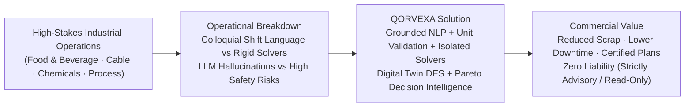
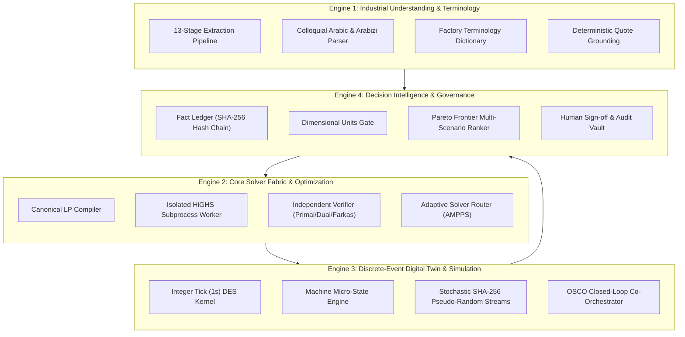
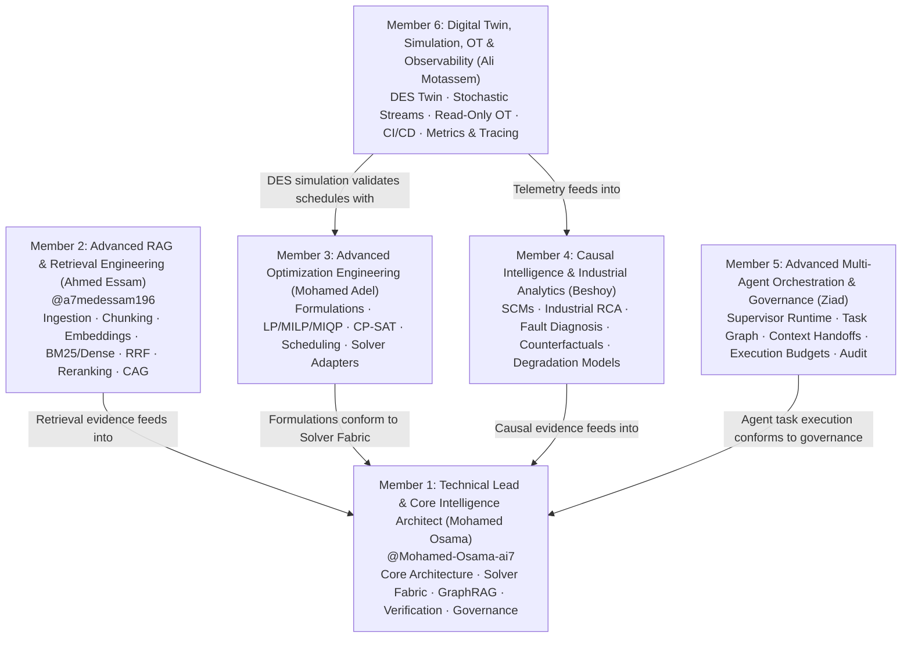

# QORVEXA — Master Project History, Technical Blueprint & Team Architecture

**Document Identifier:** `QORVEXA-MASTER-BLUEPRINT-2026.1`  
**Effective Baseline:** November 23, 2026  
**Repository:** `https://github.com/Mohamed-Osama-ai7/QORVEXA`  
**Current Branch:** `docs/qorvexa/master-project-blueprint`  
**Starting Commit SHA:** `73872cc37f9a1f5a1a87a7ea8a5a0c1ef21a8d7b`  
**Test Suite Baseline:** 1,924 Backend Hermetic Tests · 75 Frontend Tests · 0 Failures  
**License:** Proprietary / Closed-Source / All Rights Reserved (See [LICENSING_TRANSITION.md](LICENSING_TRANSITION.md))

---

## Executive Overview & Non-Negotiable Epistemic Laws

**QORVEXA** is an **Industrial Decision Intelligence Platform** developed by the **QORVEXA Research Lab**. The platform solves a fundamental breakdown in modern manufacturing: the chasm between colloquial, dialectal operational reality on the factory floor and rigorous, mathematically certified optimization in enterprise management systems.

Unlike generic enterprise AI or predictive maintenance dashboards that generate unverified text or passive anomaly charts, QORVEXA enforces an end-to-end, closed-loop pipeline from dialectal factory language intake (Egyptian Arabic `عامية مصري`, Arabizi, shift notes) to verified mathematical formulations, isolated solver execution, physics-informed discrete-event simulation, and tamper-evident human governance.

### The Five Epistemic Laws of QORVEXA
1. **Separation of Cognitive and Numerical Labor:** Large Language Models (LLMs) formulate hypotheses and extract language structures; dedicated mathematical engines compute numbers; decoupled independent verifiers certify solutions; authenticated humans govern operational decisions.
2. **Immutability of the Unverified State:** `mathematicallyVerified: false` is an immutable constant during AI formulation. Under no circumstances may an LLM, prompt instruction, or heuristic agent certify mathematical correctness.
3. **Solution Proof $\ne$ Model Fidelity:** Proving that a candidate solution vector $x^*$ satisfies an optimization model $\mathcal{M}$ does **not** prove that $\mathcal{M}$ represents the physical factory. Model fidelity is an empirical engineering responsibility grounded in validated physical evidence and simulation stress-testing.
4. **Adaptive Multi-Paradigm Routing:** Real industrial problems cannot be forced into a single mathematical matrix. Problems must be adaptively classified and routed to the proper solver family (Continuous LP, Native MILP, CP-SAT, Discrete-Event Simulation, or Diagnostic RCA).
5. **Zero-Trust Solver Verification:** A solver's self-reported exit code (e.g., `OPTIMAL`) is **never** accepted as ground truth. Feasibility and optimality must be independently audited using double-precision IEEE 754 arithmetic and dimensionally scaled tolerances.

---

## 1. Evolution: FactoryMind CDT to QORVEXA

### 1.1 Academic Origins (Fall 2026)
The project originated under the name **FactoryMind CDT** (Cognitive Digital Twin / Causal Digital Twin), conceived as an applied research initiative in industrial AI and cyber-physical systems. The initial project scope, documented in the archival paper [FactoryMind_CDT_Project_Documentation_with_UI_UX.pdf](../reference/FactoryMind_CDT_Project_Documentation_with_UI_UX.pdf), proposed combining predictive maintenance on heavy industrial rotating equipment (illustrated by an operational centrifugal pump `M-004`) with causal reasoning and digital twin modeling.

### 1.2 The M0–M5 Milestone Progression
Under the technical direction of Lead Architect Mohamed Osama (`@Mohamed-Osama-ai7`), the platform transitioned from an academic concept into an operational, modular software platform across six major milestones:

| Milestone | Branch / PR | Primary Capabilities Delivered | Status |
|---|---|---|:---:|
| **M0: Engineering Foundation** | PR #1 (`666a956`) | Modular FastAPI backend, React/TypeScript SPA, CI pipeline with pinned action SHAs, read-only OT safety boundary. | **IMPLEMENTED** |
| **M1: MetroPT-3 Anomaly Pipeline** | PR #2 (`1f9a893`) | Ingestion and unsupervised anomaly detection on UCI Dataset #791 (MetroPT-3 APU compressor), `/score` and `/replay` APIs, React telemetry monitor. | **IMPLEMENTED** |
| **M2-WP0: Detection Hardening** | PR #4 (`e4e17f9`) | Nested Leave-One-Event-Out (LOEO) cross-validation protocol, physics-informed `duty_rule` baseline, `ExceedanceCalibrator`, stateful `AlarmTracker`. | **IMPLEMENTED** |
| **M2-WP1: Auth & Persistence** | PR #5 (`ba7ac37`) | OIDC resource-server authentication, 5-role RBAC, SQLite append-only persistence with SHA-256 tamper-evident hash chaining. | **IMPLEMENTED** |
| **M2-WP2: Operating Regimes & Gating** | PR #6 (`03c3fd5`) | Causal 4-regime classifier (`stopped`, `unloaded`, `loaded`, `starting`), 4-class event taxonomy, sensor data integrity gating (`stale_telemetry`, `signal_inconsistency`). | **IMPLEMENTED** |
| **M2-WP3: Event Evidence Packages** | PR #7 (`8ad761a`) | Grouped event evidence foundations, structured physical observation logging, timestamp alignment. | **IMPLEMENTED** |
| **M2-WP4: Explainable Physical RCA** | PR #8 (`004cb9a`) | Directed Acyclic Graph (DAG) causal traversal, symptom-cause hypothesis ranking, physical failure propagation analysis. | **IMPLEMENTED** |
| **M2-WP5: Decision Workspace** | PR #9 (`aa2a50b`) | Human decision review workspace, multi-action comparison, trade-off matrix, outcome verification logging. | **IMPLEMENTED** |
| **M3-WP0: Asset Digital Passport** | PR #10 (`0744c2d`) | Hardened digital asset passport (`passport.py`), nominal operating envelopes, physical sensor roles, unobserved quantity boundaries. | **IMPLEMENTED** |
| **M3-WP1: Multi-Model ML & AI4I** | PR #11 (`e58c1e4`) | Multi-model specialist catalog, UCI AI4I 2020 predictive maintenance benchmark, out-of-distribution (OOD) abstention probe. | **IMPLEMENTED** |
| **M3-WP2: Hybrid RAG & Knowledge** | PR #12 (`7842d35`) | In-memory Hybrid RAG (BM25 + dense retrieval), Reciprocal Rank Fusion (RRF), technical PDF parsing. Commit `59c88d01` contributed by Ahmed Essam. | **IMPLEMENTED** |
| **M4-WP0: Discrete-Event Digital Twin** | PR #13 (`e33804b`) | Integer tick event clock, machine micro-states (`PROCESSING`, `STARVED`, `BLOCKED`, `DOWN`), scrap accounting, Monte Carlo pseudo-random streams. | **IMPLEMENTED** |
| **M4-WP1: Impact & Optimization** | PR #14 (`f720dd5`) | Canonical LP compiler, bounded maintenance scheduling, production planning formulation. | **IMPLEMENTED** |
| **M4-WP2: Controlled Industrial Copilot** | PR #15 (`a67542d`) | Read-only copilot runtime, citation grounding, red-team prompt guardrails, zero-actuation enforcement. | **IMPLEMENTED** |
| **M5-WP0: Read-Only OT Connectors** | PR #16 (`77cbeb0`) | Edge connector descriptors for OPC UA, MQTT, and Historians; URL syntax validation, batch preflight check. | **PARTIALLY IMPLEMENTED** |

### 1.3 Re-Branding to QORVEXA & Commercial Transition
In late November 2026, the project underwent a formal strategic re-positioning:
- **Product Name:** **QORVEXA**
- **Descriptor:** **Industrial AI Research Lab**
- **Product Category:** **Industrial Decision Intelligence Platform**
- **Licensing Transition:** The codebase transitioned from its historical open-source MIT evaluation window (commits `77cbeb0` through `2335e58`) to a closed-source **Proprietary / All Rights Reserved** commercial license (commit `bb04cba` onward). The legal boundaries and non-retroactivity principles are documented in [LICENSING_TRANSITION.md](LICENSING_TRANSITION.md).

---

## 2. Product Vision & Commercial Strategy

### 2.1 Target Industry Verticals
QORVEXA targets complex manufacturing and process environments characterized by:
1. **Multi-Stage Dependent Production:** Lines where upstream starvation or downstream blocking cascades across machines (e.g., continuous cable extrusion, beverage packaging).
2. **Shift-Based Dialectal Reporting:** Plants where operators log events in colloquial dialects (e.g., Egyptian Arabic, Arabizi, multilingual jargon) that standard ERP/MES systems cannot parse.
3. **Strict Dimensional & Scrap Constraints:** Operations where material wastage, specific energy consumption, and unit mismatches carry heavy financial penalties.
4. **High Downtime Costs:** Facilities where unpredicted compressor or motor failure halts entire production sections ($>\$10,000/\text{hr}$).

### 2.2 Commercial Operating Model
- **Enterprise Platform Licensing:** Tiered commercial licensing based on connected facilities, monitored assets, and solver worker concurrency.
- **Factory-Isolated Data Tenancy:** Append-only SQLite WAL ledgers and terminology dictionaries isolated per factory ID. No cross-tenant data leakage.
- **Strict Advisory Boundary:** QORVEXA enforces an absolute read-only architectural invariant. The software provides mathematically verified decision packages and recommendations to authorized human managers, completely eliminating physical liability for industrial actuation.

---

## 3. Full System Architecture & 12-Stage Workflow

The core architecture operates as an asynchronous, deterministic pipeline spanning from dialectal text intake to human sign-off:

```mermaid
flowchart TD
    S1["1. Factory Language Intake\n(Colloquial Shift Notes, Audio Transcripts, Operator Logs)"] --> S2["2. Language Understanding & Grounding\n(13-Stage Extraction · Quote Offsets · Contradiction Checks)"]
    S2 --> S3["3. Factory Terminology Resolution\n(Isolated SQLite Dictionary · Versioned Reviewed Terms)"]
    S3 --> S4["4. Untrusted Proposal Generation\n(Tagged Candidate Claims · Evidence Bounding)"]
    S4 --> S5["5. Fact Ledger Admission\n(Append-Only SQLite WAL · SHA-256 Tamper-Evident Hash Chain)"]
    S5 --> S6["6. Strict Dimensional Units Gate\n([M]^a [L]^b [T]^c [Theta]^d Dimensional Invariant Verification)"]
    S6 --> S7["7. Canonical Formulation Compiler\n(c^T x · A x <= b · Variable Lower/Upper Bounds)"]
    S7 --> S8["8. Core Solver Fabric\n(Isolated HiGHS Subprocess · Win32 Job Object · JSON-IPC)"]
    S8 --> S9["9. Independent Mathematical Verifier\n(Double-Precision Primal/Dual Residuals · Duality Gap · Farkas Rays)"]
    S9 --> S10["10. Discrete-Event Digital Twin\n(1-Second Integer Tick Clock · Micro-States · Stochastic Seeds)"]
    S10 --> S11["11. OSCO Co-Orchestration Loop\n(Solve <--> Simulate Iterative Refinement · Bottleneck Tuning)"]
    S11 --> S12["12. Decision Intelligence & Governance\n(Multi-Scenario Pareto Frontier · Authenticated Sign-off · Audit Log)"]
```

### The 12 Pipeline Stages

1. **Factory Language Intake:** Ingests raw, unstructured operational shift notes, maintenance logs, and spoken operator inputs in colloquial Egyptian Arabic (`عامية مصري`), Arabizi, formal Arabic, and English.
2. **Language Understanding & Grounding:** Executes a 13-stage deterministic extraction pipeline. Every extracted quantity, constraint, or event is grounded with character-exact offsets against the original raw source text.
3. **Factory Terminology Resolution:** Resolves informal nicknames ("الكمبروسر الكبير", "خط التعبئة 2") against a factory-scoped, auditable dictionary of confirmed plant assets.
4. **Untrusted Proposal Generation:** Emits structured proposal candidates. All extracted claims remain explicitly tagged as `UNTRUSTED` proposals until verified.
5. **Fact Ledger Admission:** Validates proposals against existing knowledge. Admitted facts are committed to an append-only SQLite WAL ledger linked by cryptographic SHA-256 hash chains.
6. **Strict Dimensional Units Gate:** Verifies physical dimensional consistency ($[M]^a [L]^b [T]^c [\Theta]^d$) across all quantities, rejecting dimensionally incompatible constraints (e.g., adding hours to kilograms).
7. **Canonical Formulation Compiler:** Translates verified facts into a standard canonical optimization model $\min c^T x \text{ s.t. } A x \le b, l \le x \le u$.
8. **Core Solver Fabric:** Dispatches the canonical formulation to an isolated mathematical solver worker enclosed in a Win32 Job Object or POSIX cgroup with strict CPU time, memory (4GB default), and JSON-IPC communication.
9. **Independent Mathematical Verifier:** Independently recalculates primal and dual residuals, duality gaps, and Farkas infeasibility certificates in double-precision arithmetic, without trusting solver status flags.
10. **Discrete-Event Digital Twin:** Ingests the verified mathematical plan into a 1-second tick simulation kernel to model real-world machine micro-states (`PROCESSING`, `STARVED`, `BLOCKED`, `DOWN`), buffer capacities, and scrap generation.
11. **Optimization–Simulation Co-Orchestration (OSCO):** Closes the loop between mathematical optimization and simulation. Identifies where optimal plans fail operationally, proposes evidence-justified capacity adjustments, and re-solves.
12. **Decision Intelligence & Governance:** Constructs multi-criteria Pareto trade-off packages, presents ranked operational scenarios, requires authenticated human sign-off, and writes permanent audit trail records.

---

## 4. The Four Core Platform Engines

QORVEXA is structured around four foundational engines:

### Engine 1: Industrial Language Understanding & Factory Terminology
- **Package Path:** `backend/src/qorvexa/industrial/understanding/`
- **Active Tests:** 43 tests in `tests/test_industrial_understanding.py`
- **Capabilities:** 13-stage deterministic pipeline (`qorvexa-understanding/1`). Normalizes Egyptian Arabic (`عامية مصري`), Arabizi, and English; extracts numbers in Arabic-Indic and spoken formats; binds entities via `TerminologyStore`; enforces character-exact quote grounding; detects contradictions only within identical operational scopes.

### Engine 2: Core Solver Fabric & Mathematical Optimization
- **Package Path:** `backend/src/qorvexa/solver_fabric/`
- **Active Tests:** 21 tests in `tests/test_sf_highs_adapter.py`, 12 tests in `tests/test_sf_verifier.py`
- **Capabilities:** Isolated worker process model communicating over standard JSON-IPC; HiGHS 1.16.0 continuous LP solving; decoupled `IndependentVerifier` validating primal feasibility $\|Ax^* - b\|_\infty \le \epsilon_{\text{feas}}$, dual feasibility $\|A^T y^* - c\|_\infty \le \epsilon_{\text{dual}}$, and relative duality gap $|c^T x^* - b^T y^*| / (1 + |c^T x^*|) \le \epsilon_{\text{gap}}$.

### Engine 3: Discrete-Event Digital Twin & Operational Simulation
- **Package Path:** `backend/src/qorvexa/industrial/digital_twin/` & `qorvexa/industrial/co_orchestration/`
- **Active Tests:** 55 tests in `test_industrial_digital_twin.py`, 24 tests in `test_optimization_simulation_orchestration.py`
- **Capabilities:** Discrete-event simulation running on an exact 1-second integer tick clock; machine state accounting (`PROCESSING`, `STARVED`, `BLOCKED`, `DOWN`); scrap generation and buffer tracking; deterministic SHA-256 seeded pseudo-random streams per replication; OSCO closed-loop refinement loop between HiGHS plans and simulation bottlenecks.

### Engine 4: Industrial Decision Intelligence & Fact Governance
- **Package Path:** `backend/src/qorvexa/industrial/governance/` & `qorvexa/industrial/decision_intelligence/`
- **Active Tests:** 13 tests in `test_governance.py`, 84 tests in `test_decision_intelligence*.py`
- **Capabilities:** Append-only SQLite WAL persistence with cryptographic SHA-256 hash chaining; untrusted proposal review lifecycle; strict dimensional units analysis ($[M]^a [L]^b [T]^c [\Theta]^d$); multi-scenario Pareto frontier calculation, 50-digit exact `Decimal` comparisons, and executive decision briefs.

---

## 5. RAG, Retrieval, Embeddings & GraphRAG

### 5.1 Hybrid Search & Retrieval Internals (IMPLEMENTED)
- **Source Module:** [backend/src/qorvexa/knowledge/rag.py](../../backend/src/qorvexa/knowledge/rag.py)
- **Active Tests:** 12 tests in `test_knowledge_rag_kg.py`
- **Algorithm:** Combines sparse BM25 keyword matching with dense embedding vector similarity using **Reciprocal Rank Fusion (RRF)**:
  $$RRF(d) = \sum_{m \in \{\text{BM25}, \text{Dense}\}} \frac{1}{k + r_m(d)}$$
  where $k = 60$ and $r_m(d)$ is the ordinal rank of document chunk $d$ in system $m$.
- **Chunking Strategy:** Structural markdown section chunking with exact character boundaries (minimum 30 characters, maximum 1,800 characters per segment).
- **Corpus & Passports:** Ingests asset digital passports (`passport.py`), repository technical specifications, and the official MetroPT-3 Data Description PDF.
- **Licensing Compliance:** PDF chunks are tagged `CC BY 4.0 (UCI #791)`; repository documentation chunks are tagged `Proprietary (Repository Documentation)`.

### 5.2 Advanced GraphRAG Architecture (RESEARCH / DESIGN ONLY)
- **Documentation:** [INDUSTRIAL_ONTOLOGY.md](INDUSTRIAL_ONTOLOGY.md)
- **Architecture:** Authored by Technical Lead Mohamed Osama (`@Mohamed-Osama-ai7`). Specifies multi-hop graph traversal across factory equipment hierarchies, asset failure modes, and operational constraints. Distinguishes structural graph reachability from unverified text embeddings.
- **Implementation Status:** The underlying relational ontology store is implemented (`test_industrial_ontology.py`), but autonomous multi-hop agentic graph traversal is currently in **Research / Design Only** status.

---

## 6. Solver Fabric, Optimization Methods & AMPPS

### 6.1 Isolated Worker Execution Protocol (IMPLEMENTED)
Solvers execute in decoupled worker processes enclosed in Win32 Job Objects (or Linux cgroups) with hard limits:
- **Max Memory Cap:** 4 GB default limit; processes exceeding memory are terminated immediately by the operating system watchdog.
- **Execution Timeout:** Strict deadline enforcement; timeouts kill the worker cleanly without leaving orphaned subprocesses.
- **Framed JSON-IPC:** Input problems and output solution vectors communicate over length-prefixed stdin/stdout streams.

### 6.2 Implementation Status Across Optimization Methods
To uphold absolute mathematical honesty, the repository distinguishes implemented solvers from future roadmap targets:

| Optimization Subsystem | Maturity Status | Technical Evidence & Capabilities |
|---|:---:|---|
| **Continuous Linear Programming (LP)** | **`IMPLEMENTED`** | HiGHS 1.16.0 continuous simplex and interior-point method (IPM) solves. Full primal and dual ray extraction. Verified in `test_sf_highs_adapter.py`. |
| **Independent LP Verifier** | **`IMPLEMENTED`** | Decoupled verification of primal feasibility, dual feasibility, and duality gap in `verifier.py`. |
| **Mixed-Integer Linear Programming (Native MILP)** | **`PLANNED / NOT IMPLEMENTED`** | Integer handling is currently limited to post-solve heuristic rounding of continuous LP solutions. This is **not** a native branch-and-cut MILP solver. Full MILP adapter is assigned to Member 3 (Mohamed Adel). |
| **Constraint Programming (CP-SAT)** | **`PLANNED`** | Discrete scheduling and machine sequencing models using OR-Tools CP-SAT are planned for Workstream 3. |
| **Nonlinear Programming (NLP)** | **`PLANNED`** | Continuous nonlinear optimization with KKT point verification is planned for future research phases. |

### 6.3 Adaptive Multi-Paradigm Problem Solving (AMPPS) (DESIGNED)
Defined in [PROBLEM_SOLVER_CONTRACT_ARCHITECTURE.md](PROBLEM_SOLVER_CONTRACT_ARCHITECTURE.md), AMPPS dynamically classifies the mathematical structure of an incoming industrial problem and routes it to the optimal paradigm:
- Continuous capacity allocation $\rightarrow$ **Continuous LP**
- Machine sequencing and shift scheduling $\rightarrow$ **CP-SAT / MILP**
- Non-convex physical fluid dynamics $\rightarrow$ **ODE Digital Twin Simulation**
- Sensor anomaly isolation $\rightarrow$ **Diagnostic RCA**

---

## 7. Causal Intelligence & Industrial Analytics

### 7.1 Physics-Informed Anomaly Detection (IMPLEMENTED)
- **Dataset:** UCI Dataset #791 — MetroPT-3 APU air compressor on Lisbon electric train #054 (2020).
- **Physical Sensor Envelope:** 7 analog telemetry streams: pressure (`bar`), motor current (`A`), temperatures (`°C`), oil level, flow rate.
- **Physics Baseline (`duty_rule`):** Implements a physics-informed operational duty rule tracking compressor active cycle duration against receiver pressure buildup rate ($dP/dt$).
- **Statistical Model (`pca_spe`):** Squared Prediction Error on Principal Component Analysis residual space with exceedance calibration.
- **Operating Regime Classifier:** Segregates telemetry into 4 distinct physical regimes: `stopped`, `unloaded`, `loaded`, `starting`.
- **Integrity Gating:** Automatically detects and abstains upon `stale_telemetry` ($>60\text{s}$ repeated flatline) or `signal_inconsistency` (current active while pressure reports zero).

### 7.2 Explainable Root-Cause Analysis (RCA) (IMPLEMENTED / PROTOTYPE)
- **Implementation:** `backend/src/qorvexa/anomaly/` and `rca_cases.v1.jsonl` benchmark suites.
- **Capabilities:** Traverses directed causal graphs representing component relationships (Compressor $\rightarrow$ Air Dryer $\rightarrow$ Reservoir $\rightarrow$ Brake Valves) to attribute anomalies to specific root causes (e.g., air leak, intake valve failure, pressure switch failure).
- **Epistemic Standard:** All causal claims must remain evidence-grounded. Statistical correlation or co-occurrence is strictly forbidden from being reported as causal attribution.

---

## 8. Digital Twin & Discrete-Event Simulation

### 8.1 Simulation Kernel Architecture (IMPLEMENTED)
- **Package Path:** `backend/src/qorvexa/industrial/digital_twin/`
- **Clock Resolution:** Exact integer ticks (1 tick = 1 second). Continuous time durations from operational shift inputs are converted via the Units Engine (`1.5 min` $\rightarrow 90\text{s}$). Fractional seconds are rejected as `DURATION_NOT_ON_RESOLUTION`.
- **Machine State Accounting:** Every machine tracks cumulative seconds in:
  - `PROCESSING`: Active transformation of production units.
  - `STARVED`: Idle awaiting upstream parts or raw materials.
  - `BLOCKED`: Finished part unable to unload due to full downstream buffer.
  - `DOWN`: Unplanned failure or planned maintenance shift.
- **Stochastic Disturbance Modeling:** Independent pseudo-random streams per replication generated via deterministic SHA-256 seeding (`seed:replication:stream`), supporting Triangular and Exponential downtime distributions.

### 8.2 Optimization–Simulation Co-Orchestration (OSCO) (IMPLEMENTED)
- **Package Path:** `backend/src/qorvexa/industrial/co_orchestration/`
- **Core Loop:** Ingests a mathematically optimal LP plan, converts quantities to simulation orders under an explicit `QuantityPolicy`, simulates stochastic execution, detects buffer overflows and line starvations, and dynamically refines LP capacity bounds based solely on physical simulation evidence.

---

## 9. Read-Only Industrial Integration

### 9.1 Edge Connector Descriptors (PARTIALLY IMPLEMENTED)
- **Source Path:** [backend/src/qorvexa/connectors/](../../backend/src/qorvexa/connectors/)
- **Protocols Supported:** OPC UA (`opc.tcp://`), MQTT (`mqtt://`, `mqtts://`), Industrial Historians (OSIsoft PI, InfluxDB).
- **Current Capabilities:** In-memory source descriptors, URL syntax validation, network connection preflight checks, and supply-chain software attestation (`attestation.py`).

### 9.2 Strict Physical Safety Boundary (INVARIANT)
To ensure absolute zero risk of industrial accidents or property damage:
- **Zero Actuation Invariant:** QORVEXA contains **no software pathways, socket write commands, or protocol payloads capable of actuating physical machinery, altering PLC ladder logic, or modifying DCS setpoints**.
- **Advisory Architecture:** All system outputs are packaged as advisory decision packages requiring explicit human sign-off.

---

## 10. Multi-Agent Orchestration & Governance

### 10.1 Supervisor & Specialist Architecture (PARTIALLY IMPLEMENTED)
- **Source Paths:** `backend/src/qorvexa/copilot/` & `backend/src/qorvexa/agents/`
- **Execution Model:** Supervisor agent orchestrating specialized sub-agents (Retrieval Agent, Anomaly Diagnostics Agent, Formulation Agent, Simulation Agent).
- **Execution Governance:**
  - Strict wall-clock timeouts and cancellation token propagation.
  - Per-task token consumption budgets.
  - Idempotent task retry policies.
  - Untrusted proposal isolation: Agent outputs are stored as proposals and cannot write directly to the Fact Ledger.

### 10.2 Red-Team Prompt Guardrails (IMPLEMENTED)
- The copilot runtime enforces red-team guardrails against prompt injection, unauthorized physical control queries, and hallucinations.
- The copilot abstains with an explicit safety refusal whenever asked to command machinery or bypass verification gates.

---

## 11. Decision Intelligence & Governance

### 11.1 Fact Ledger & Cryptographic Provenance (IMPLEMENTED)
- **Package Path:** `backend/src/qorvexa/industrial/governance/`
- **Storage:** Isolated SQLite WAL database per factory tenant.
- **Hash Chain:** Every admitted fact record stores a SHA-256 hash computed over its sequence ID, timestamp, entity references, numeric values, and the previous record's hash ($H_i = \text{SHA256}(H_{i-1} \parallel \text{Payload}_i)$). Tampering with historical records invalidates the ledger chain.

### 11.2 Multi-Scenario Pareto Frontier Analysis (IMPLEMENTED)
- **Package Path:** `backend/src/qorvexa/industrial/decision_intelligence/`
- **Comparison Engine:** High-precision 50-digit exact `Decimal` arithmetic.
- **Pareto Efficiency:** Computes non-dominated operational plans across conflicting objectives (e.g., maximizing throughput margin while minimizing overtime cost and makespan).
- **Decision Packages:** Generates executive briefs detailing trade-offs, binding constraints (`BECAME_BINDING`, `NO_LONGER_BINDING`), and demand shortfalls.

---

## 12. Models, Algorithms, Technologies & Research Catalog

### 12.1 Mathematical & Computational Technologies
- **Linear Programming Solver:** HiGHS 1.16.0 (`highspy==1.16.0`) isolated subprocess.
- **Scientific Computing:** NumPy (`numpy==2.5.4`), SciPy (`scipy==1.18.1`), Pandas (`pandas==3.1.1`).
- **Precision Arithmetic:** Python standard library `Decimal` (50-digit precision) and `fractions.Fraction`.

### 12.2 Machine Learning & Statistical Algorithms
- **Physics Baseline:** `duty_rule` (air compressor duty-cycle physics baseline).
- **Anomaly Detection:** `isolation_forest` (Scikit-learn `IsolationForest`), `pca_spe` (Principal Component Analysis Squared Prediction Error).
- **Statistical Calibration:** `ExceedanceCalibrator` (extreme value exceedance probabilities), `AlarmTracker` (persistence-filtered alert states).
- **Evaluation Protocols:** Nested Leave-One-Event-Out (LOEO) cross-validation, precision-recall curve analysis, False Alarms per Operational Day (FA/op d).

### 12.3 NLP & Understanding Technologies
- **Language Pipeline:** 13-stage deterministic extraction pipeline (`understanding-pipeline/1.0`).
- **Multilingual Tokenizer:** Regex-based Arabic-Indic digit normalizer, Arabizi mapping table, Egyptian dialectal lexicon.
- **Provider Adapters:** Neutral LLM adapter interfaces (`LLMProvider`, `UnavailableProvider`) with strict schema parsing.

### 12.4 Web & Infrastructure Stack
- **Backend Framework:** FastAPI 0.162.2, Starlette 1.10.0, Pydantic 2.14.3, Uvicorn 0.54.0.
- **Frontend Framework:** React 19, TypeScript 5.7, Tailwind CSS v4, Vite 8, TanStack Router, Biome 2.6.6.
- **Packaging & Tooling:** Astral `uv` (locked deterministic Python virtualenv), `npm` (clean install locked `package-lock.json`).

### 12.5 Physical Dataset & Benchmark Catalog
1. **UCI MetroPT-3 APU Dataset (#791, 2020):** Continuous 1-second telemetry from an APU compressor on an electric passenger train in Lisbon, Portugal. Contains real physical sensor failure modes (air leaks, oil leaks, pressure switch failures).
2. **UCI AI4I 2020 Predictive Maintenance Dataset:** Synthetic dataset reflecting real milling machine tool wear, heat dissipation failure, power failure, and overstrain failure.
3. **Synthetic Industrial Production Planning Benchmarks:**
   - `planning_cases.v0.jsonl` & `planning_cases.v1.jsonl`: Cairo Food Processing (bottling & packaging), Alexandria Cable Manufacturing (wire drawing & annealing).
   - `rca_cases.v0.jsonl` & `rca_cases.v1.jsonl`: Grounded physical failure scenarios for root-cause analysis evaluation.
   - `retrieval_cases.v0.jsonl` & `retrieval_cases.v1.jsonl`: Multi-aspect technical manual search queries.

---

## 13. First Industrial Vertical & Applied Use Cases

### 13.1 Use Case 1: Industrial APU Compressor Health & Anomaly Management
- **Industrial Setting:** Rail transportation, pneumatic automation, factory compressed-air utilities.
- **Problem:** Unpredicted compressor failures cause emergency braking or line depressurization, halting factory operations.
- **QORVEXA Solution:** Grounded sensor telemetry ingests into the 4-regime classifier; `duty_rule` and `pca_spe` detect early valve or line leakage $50\text{ minutes}$ prior to catastrophic failure; RCA engine attributes failure to air dryer vs. valve seal.

### 13.2 Use Case 2: Multi-Line Food & Beverage Bottling Optimization (Cairo Benchmark)
- **Industrial Setting:** High-speed consumer goods packaging (Cairo Food Processing Plant #1).
- **Problem:** Production planners receive colloquial shift handoff notes ("الخط التاني فيه مشكلة في البكر والإنتاج واقف بقاله ساعتين"). Planning manually in spreadsheets leads to stockouts and late shipments.
- **QORVEXA Solution:** Egyptian Arabic shift note is ingested; entity resolution binds Line 2; Fact Ledger records the 2-hour downtime; canonical formulation compiler generates shift-bounded optimization; HiGHS solves line quantities; Digital Twin DES verifies that packaging buffer capacities are not exceeded; Pareto decision brief is delivered to the plant manager for approval.

### 13.3 Use Case 3: Energy-Constrained Cable Extrusion Scheduling (Alexandria Benchmark)
- **Industrial Setting:** Continuous heavy manufacturing (Alexandria Cable Manufacturing).
- **Problem:** Annealing ovens and continuous extrusion lines face heavy penalty tariffs during peak grid energy hours. Scrap increases exponentially if a continuous run is halted prematurely.
- **QORVEXA Solution:** Multi-period canonical formulation models energy peak tariffs and minimum continuous run lengths; OSCO loop simulates scrap accumulation during machine setup phases; refined decision package balances overtime labor against electrical peak tariffs.

---

## 14. Mohamed Osama's Architecture & Technical Direction

### 14.1 Foundational Architecture Leadership
Mohamed Osama (`@Mohamed-Osama-ai7`) conceived, architected, and led the development of QORVEXA from its inception as FactoryMind CDT through its commercial enterprise evolution. His direct technical contributions encompass:

1. **Core Architectural Specifications:** Authored the foundational Architecture Decision Records (ADRs), the canonical Research Lab to Solver Fabric contract ([PROBLEM_SOLVER_CONTRACT_ARCHITECTURE.md](PROBLEM_SOLVER_CONTRACT_ARCHITECTURE.md)), the Options A & B architecture contracts, and the 22-subsystem maturity matrix.
2. **Solver Fabric & Verification Contracts:** Conceived the decoupled Independent Verifier architecture, establishing the epistemic principle that solver status flags must never be trusted without double-precision mathematical auditing.
3. **Evaluation Harness & Provenance:** Implemented the strict benchmark evaluation harness (`qorvexa.evaluation`), establishing frozen split manifests, evaluation leakage audits, and tamper-evident run tracking.
4. **Safety & Security Invariants:** Established the non-negotiable physical OT read-only safety boundary, preventing autonomous actuation and guaranteeing that all system decisions require authenticated human sign-off.

### 14.2 Separation of Technical Leadership from Collaborator Contributions
To maintain rigorous historical integrity:
- Mohamed Osama directed overall system architecture, contracts, and core platforms.
- Ahmed Essam (`@a7medessam196`) contributed hybrid RAG enhancements and search evaluation (commit `59c88d01`).
- AI implementation subagents (Claude Code, Antigravity) operated under Mohamed Osama's explicit design prompts and architecture specifications to implement modules, repair quality gates, and maintain hermetic test suites.

---

## 15. Comprehensive 22-Subsystem Implementation Status

Every subsystem is audited against live code and hermetic tests in `collaboration/qorvexa-current`:

| # | Subsystem Name | Maturity Classification | Primary Source Paths | Active Tests | Capabilities & Evidence |
|---|---|:---:|---|---|---|
| **1** | **Solver Fabric Core** | **`IMPLEMENTED`** | `backend/src/qorvexa/solver_fabric/` | `test_sf_highs_adapter.py` (21) | Isolated subprocess worker, Win32 Job Object enclosure, JSON-IPC framing, 4GB memory watchdog, exact timeout recovery. |
| **2** | **Continuous LP Solvers** | **`IMPLEMENTED`** | `backend/src/qorvexa/solver_fabric/highs_*.py` | `test_sf_highs_adapter.py` | HiGHS 1.16.0 continuous LP solving, exact primal/dual solution parsing, dual ray / Farkas ray extraction. |
| **3** | **Native MILP Solvers** | **`PLANNED / NOT IMPLEMENTED`** | `backend/src/qorvexa/solver_fabric/` | N/A | Heuristic rounding of LP solutions exists; native branch-and-cut MILP adapter is assigned to Member 3 (Mohamed Adel). |
| **4** | **Constraint Programming (CP-SAT)**| **`PLANNED`** | `backend/src/qorvexa/solver_fabric/` | N/A | Discrete machine scheduling and combinatorial optimization via OR-Tools CP-SAT planned for Workstream 3. |
| **5** | **Solver Independent Verifier** | **`IMPLEMENTED`** | `backend/src/qorvexa/solver_fabric/verifier.py` | `test_sf_verifier.py` (12) | Independent double-precision verification of primal/dual residuals, duality gap, Farkas rays, condition number checks. |
| **6** | **Industrial Language Understanding**| **`IMPLEMENTED`** | `backend/src/qorvexa/industrial/understanding/` | `test_industrial_understanding.py` (43) | 13-stage deterministic extraction pipeline, Egyptian colloquial (`عامية مصري`), Arabizi, English, quote grounding. |
| **7** | **Ontology & Context Engine** | **`IMPLEMENTED`** | `backend/src/qorvexa/industrial/ontology/` | `test_industrial_ontology.py` (70) | Factory entity resolution, equipment hierarchy, candidate scoring, event-sourced SQLite graph state. |
| **8** | **Retrieval & Hybrid RAG** | **`IMPLEMENTED`** | `backend/src/qorvexa/knowledge/` | `test_knowledge_rag_kg.py` (12) | BM25 sparse search + dense vector retrieval, Reciprocal Rank Fusion (RRF), document chunking, CAG cache. |
| **9** | **Advanced GraphRAG** | **`RESEARCH / DESIGN ONLY`** | `docs/qorvexa/INDUSTRIAL_ONTOLOGY.md` | None | Multi-hop graph traversal architecture and agentic routing specified by Architect; code implementation pending. |
| **10** | **Causal Intelligence** | **`PROTOTYPE / EXPERIMENTAL`** | `backend/src/qorvexa/causal/` & `anomaly/` | `test_causal_*.py`, `test_anomaly_*.py` | Simple DAGs, observational conditioning, failure propagation analysis; Pearl do-calculus planned for Workstream 4. |
| **11** | **Multi-Agent Orchestration** | **`PARTIALLY IMPLEMENTED`** | `backend/src/qorvexa/copilot/` & `agents/` | `test_agent_*.py`, `test_copilot_*.py` | Supervisor/worker execution, timeout limits, red-team guardrails; distributed queue planned for Workstream 5. |
| **12** | **Discrete-Event Digital Twin** | **`IMPLEMENTED`** | `backend/src/qorvexa/industrial/digital_twin/` | `test_industrial_digital_twin.py` (55) | 1-second integer tick clock, machine micro-states (`PROCESSING`, `STARVED`, `BLOCKED`, `DOWN`), scrap accounting. |
| **13** | **OSCO Co-Orchestration** | **`IMPLEMENTED`** | `backend/src/qorvexa/industrial/co_orchestration/`| `test_optimization_simulation_orchestration.py` (24) | Iterative solve $\leftrightarrow$ simulate refinement, operational violation detection, calendar-bounded adjustments. |
| **14** | **Stochastic Optimization** | **`PARTIALLY IMPLEMENTED`** | `backend/src/qorvexa/industrial/digital_twin/stochastic.py` | `test_industrial_digital_twin.py` | Deterministic SHA-256 pseudo-random streams per replication, Triangular/Exponential distributions. |
| **15** | **Industrial Scenario Library** | **`IMPLEMENTED`** | `backend/benchmarks/qorvexa/` | `test_evaluation_splits.py` | Real MetroPT-3 compressor physical data (2020) + synthetic operational planning benchmarks (Cairo, Alexandria). |
| **16** | **Read-Only OT Integration** | **`PARTIALLY IMPLEMENTED`** | `backend/src/qorvexa/connectors/` | `test_edge_connectors.py` (37) | Source descriptors, URL syntax checks, batch preflight for OPC UA / MQTT / Historian; live socket I/O deferred. |
| **17** | **Fact Ledger & Governance** | **`IMPLEMENTED`** | `backend/src/qorvexa/industrial/governance/` | `test_governance.py` (13) | Append-only SQLite WAL store, SHA-256 hash chains, untrusted proposal lifecycle, admission gate. |
| **18** | **Decision Intelligence** | **`IMPLEMENTED`** | `backend/src/qorvexa/industrial/decision_intelligence/`| `test_decision_intelligence*.py` (84) | Pareto frontier calculation, multi-scenario ranking, trade-off matrix, executive briefs, 50-digit `Decimal` comparisons. |
| **19** | **Advisory Industrial REST API** | **`IMPLEMENTED`** | `backend/src/qorvexa/api/industrial.py` | `test_industrial_api_e2e.py` | FastAPI endpoints for intake, terminology, proposals, facts, solve, simulate, approve; zero actuation. |
| **20** | **Production Planning Studio UI**| **`IMPLEMENTED`** | `frontend/src/features/planning/` | Vitest (75 tests across 20 files) | React 19 UI: Egyptian Arabic intake presets, terminology manager, fact board, formulation view, solver progress, approvals. |
| **21** | **Testing & Evaluation Harness** | **`IMPLEMENTED`** | `backend/tests/`, `backend/benchmarks/` | Full regression (1,924 tests) | Hermetic unit, integration, and E2E test suites; frozen benchmark splits; contamination audits. |
| **22** | **Deployment & Observability** | **`IMPLEMENTED`** | `.github/workflows/ci.yml`, `vercel.json` | `test_ci_actions_pinned_and_root_license_present` | Vercel SPA preview deployment, GitHub Actions CI workflow with pinned action SHAs, supply chain attestation. |

---

## 16. Complete Six-Person Team Ownership & Boundaries

The QORVEXA engineering organization is structured into six human workstreams. **Members 2 through 6 are beginning their assigned workstreams; their designated responsibilities represent forward-looking engineering ownership and boundaries, not previously completed personal work.**

### Member 1 — Technical Lead & Core Intelligence Architect: Mohamed Osama (`@Mohamed-Osama-ai7`)
- **Owns:** Overall system architecture, ADRs, technical roadmap, cross-engine integration standards, Core Solver Fabric architecture, solver worker execution protocols, advanced optimization architecture, GraphRAG reasoning architecture, adaptive solver routing, Fact Ledger governance, platform security, and final PR approval on shared contracts.
- **Boundaries:** Does not own specific domain formulations (Member 3) or retrieval engine internals (Member 2).

### Member 2 — Advanced RAG & Retrieval Engineering: Ahmed Essam (`@a7medessam196`)
- **Owns:** Document ingestion, technical PDF parsing, multilingual normalization, embedding model adapters, BM25 sparse + dense search, Reciprocal Rank Fusion, cross-encoder reranking, multi-query execution, CAG caching, and retrieval benchmarks (`retrieval_cases.*`).
- **Boundaries:** Does not own central GraphRAG architecture, ontology reasoning, multi-hop reasoning topology, or platform adaptive routing (owned by Member 1).

### Member 3 — Advanced Optimization Engineering: Mohamed Adel (`[GitHub Handle Pending]`)
- **Owns:** Industrial mathematical formulations (production planning, shift scheduling, cutting-stock), LP/MILP/MIQP models, constraint programming (OR-Tools CP-SAT), multi-objective optimization, stochastic optimization models, problem-specific solver adapters, and optimization benchmarks (Cairo, Alexandria).
- **Boundaries:** Does not own central Solver Fabric architecture, worker execution protocols, or solver registry (owned by Member 1).

### Member 4 — Causal Intelligence & Industrial Analytics: Beshoy (`[GitHub Handle Pending]`)
- **Owns:** Structural Causal Models (SCMs), causal DAGs, industrial Root-Cause Analysis (RCA), fault diagnosis, failure cascading models, counterfactual what-if analysis, predictive maintenance, sensor degradation curves, RUL estimation, and industrial analytics benchmarks (`rca_cases.*`).
- **Boundaries:** All causal assertions must remain evidence-grounded. Statistical correlation must never be reported as causation. Does not own Digital Twin simulation internals (Member 6) or decision packaging (Member 1).

### Member 5 — Advanced Multi-Agent Orchestration & Governance: Ziad (`[GitHub Handle Pending]`)
- **Owns:** Supervisor and specialized-agent runtime architecture, industrial task decomposition, dependency-aware task graphs, agent context handoffs, per-task execution budgets, timeouts, cancellation tokens, idempotent retry policies, and agent audit trails.
- **Boundaries:** **Strict Zero Actuation Invariant:** Agents cannot approve industrial decisions autonomously or control physical equipment. Does not own extraction NLP (Member 1) or retrieval internals (Member 2).

### Member 6 — Digital Twin, Simulation, Industrial Integration, Deployment & Observability: Ali Motassem (`[GitHub Handle Pending]`)
- **Owns:** Digital Twin foundations, discrete-event simulation (DES) kernel, stochastic Monte Carlo simulations, production KPI analysis, simulation evaluation of optimization schedules (OSCO), read-only industrial connectors (OPC UA, MQTT, Historians), CI/CD pipelines (`.github/workflows/`), containerization, structured logging, OpenTelemetry tracing, and metrics.
- **Boundaries:** **Strict Read-Only OT Boundary:** Absolutely zero write commands, setpoint changes, or actuation calls to physical plant machinery. Does not own mathematical optimization models (Member 3).

---

## 17. Integration Dependencies & Collaboration Rules

### 17.1 Cross-Workstream Contract Dependencies
To prevent integration collisions and architectural divergence:
1. **Contract-First Approval:** Any modification to shared data models under `backend/src/qorvexa/contracts/`, public REST schemas under `backend/src/qorvexa/api/`, or Solver Fabric protocols **requires explicit review and written sign-off from Technical Lead Mohamed Osama (`@Mohamed-Osama-ai7`) before business logic is written**.
2. **CI/CD Exclusivity:** Files under `.github/workflows/` are exclusively owned and maintained by Member 6 (Ali Motassem). Other team members may not alter CI workflow configurations without direct coordination.
3. **Hermetic Test Discipline:** Every pull request must include deterministic, offline, CPU-executable automated tests. Mocking out verification checks or weakening assertions is strictly grounds for immediate PR rejection.
4. **Physical OT Safety Affirmation:** Every PR template submission requires affirmative confirmation that the submitted code introduces zero socket write operations or physical actuation pathways.

### 17.2 Git Collaboration Workflow
Contributors must strictly adhere to the 9-step collaboration lifecycle defined in [DEVELOPMENT_WORKFLOW.md](DEVELOPMENT_WORKFLOW.md):
- Branch exclusively from `origin/collaboration/qorvexa-current`.
- Use conventional branch names: `feat/<member>/<feature>`, `fix/<member>/<issue>`, `research/<member>/<topic>`, `test/<member>/<scope>`, `docs/<member>/<topic>`.
- Never commit directly to `main` or `collaboration/qorvexa-current`.
- Open a PR using `.github/pull_request_template.md` with complete verification evidence.
- Review turnaround expectation: 24 to 48 business hours.

---

## 18. Historical Gaps & Epistemic Boundaries

In accordance with strict scientific and engineering honesty, the following historical information gaps are explicitly declared:

1. **Pre-Git Historical Records:** The earliest Git commit is `f5b908c` on October 19, 2026. Informal design conversations, academic coursework requirements, or oral agreements preceding this commit are not recorded in repository version control and cannot be reconstructed.
2. **Untracked Verbal Deliberations:** Technical trade-offs discussed in private meetings or personal communications that were not committed to Architecture Decision Records (ADRs) or Git commit messages are acknowledged as information gaps.
3. **Public Fork Association:** Unauthenticated GitHub forks (`beshoysaad468-sys/QORVEXA` and `AliMotassem164/FactoryMind-CDT`) exist publicly. Because formal account confirmation from the repository owner has not occurred, these accounts are not assumed to be verified collaborator identities in CODEOWNERS.
4. **Commercial Target Data Grounding:** Synthetic benchmarks (Cairo Food Processing, Alexandria Cable Manufacturing) represent mathematically rigorous simulation cases. They are not represented as live, active factory connections. The sole real physical telemetry dataset in the repository is the peer-reviewed **UCI MetroPT-3 APU air compressor dataset (#791)**.
