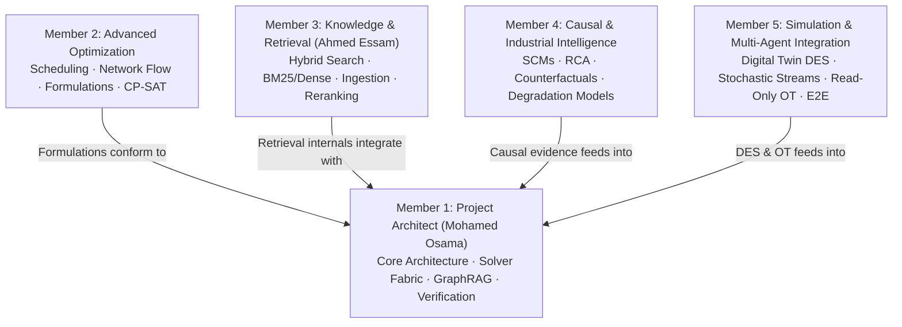

# QORVEXA — Five-Person Engineering Team Workstreams

**Document Status:** Official Team Governance & Ownership Specification  
**Effective Date:** November 23, 2026  
**Product:** QORVEXA (Industrial Decision Intelligence Platform)  
**Team Composition:** 5 Human Engineers (AI assistants are developer tools, not team members)

---

## 1. Governance Principles

To maintain velocity without code collision or architectural divergence:
1. **Clear Workstream Ownership:** Each contributor owns distinct subsystems and deliverables.
2. **Shared Contract Invariant:** Shared interfaces (Solver Fabric, Ontology, Fact Ledger, Units, API) are owned and guarded by the Project Architect. No contributor may alter a shared contract without prior architect coordination.
3. **Evidence-Grounded Engineering:** All claims, formulations, causal assertions, and benchmark results must be supported by automated tests and verifiable evidence.
4. **Advisory Safety Boundary:** No workstream may implement write access to physical industrial automation (PLCs, DCS, SCADA).

---

## 2. Workstream Allocation & Ownership Matrix

---

### Member 1 — Project Architect: Mohamed Osama (`@Mohamed-Osama-ai7`)

**Primary Responsibilities:**
- **Overall System Architecture:** Technical roadmap, repository governance, cross-engine contract definitions, and release readiness.
- **Core Solver Fabric Architecture:** Isolated solver worker design, JSON-IPC protocols, execution watchdogs, and timeout recovery.
- **Advanced Mathematical Optimization:** Primal/dual feasibility verification, duality gap checking, Farkas ray extraction, and mathematical soundness.
- **Adaptive Multi-Paradigm Problem Solving (AMPPS):** Paradigm routing (Continuous LP, MILP, CP, Heuristic, Simulation), problem classifier, and solver selection.
- **Advanced GraphRAG & Retrieval Architecture:** Multi-hop graph traversal architecture, adaptive retrieval routing, agentic retrieval planning, and epistemic boundaries.
- **Core Governance & Admission:** Fact Ledger tamper-evident hash chaining, strict dimensional unit admission gate, and audit logging.
- **Final Architecture & PR Review:** Final approval on all Pull Requests modifying shared contracts, public APIs, or core schemas.

---

### Member 2 — Advanced Optimization Engineering (`[Workstream 2 Owner — Role Placeholder]`)

**Primary Responsibilities:**
- **Industrial Problem Classes:** Specialized mathematical formulations for production planning, shift scheduling, machine sequencing, resource allocation, and cutting-stock problems.
- **Continuous & Discrete Solvers:** Mathematical formulations for mixed-integer programming (MILP), network flow, constraint programming (CP-SAT), and multi-period lot sizing.
- **Formulation Benchmarks:** Standard industrial benchmarks (e.g., Cairo Food Processing, Alexandria Cable Manufacturing, energy-constrained scheduling).
- **Solver Adapters:** Dedicated adapters conforming to the Solver Fabric worker contract.
- **Boundaries & Dependencies:** Must build against Member 1's `CanonicalLp` and `SolverFabricWorkerContract` interfaces; must not redesign the underlying solver subprocess or verification engine.

---

### Member 3 — Advanced Retrieval & Knowledge Engineering: Ahmed Essam (`@a7medessam196`)
- **Verified GitHub Handle:** `@a7medessam196`
- **Contributor Email:** `a7med.essam196@gmail.com`
- **Assigned Subsystems:** Knowledge & Retrieval Engine (`backend/src/qorvexa/knowledge/`), Document Ingestion, Hybrid Search Evaluation (`retrieval_cases.*`).

**Primary Responsibilities:**
- **Hybrid Retrieval Internals:** BM25 sparse keyword search, dense embedding integration, Reciprocal Rank Fusion (RRF), and cross-encoder reranking.
- **Document Ingestion & Structural Parsing:** Technical PDF extraction, maintenance manual chunking, asset passport parsing, and document provenance tracking.
- **Multilingual Support:** Technical Arabic, English, and transliterated industrial shop-floor query parsing.
- **Context-Augmented Generation (CAG):** In-memory cache structures, retrieval invalidation on document updates, and cache eviction policies.
- **Retrieval Observability & Benchmarks:** Precision@K, Recall@K, MRR, and NDCG benchmarking against MetroPT-3 and industrial knowledge corpora.
- **Strict Ownership Boundary:** Ahmed owns retrieval engine internals, parsing, and search evaluation. The Project Architect (Member 1) owns Advanced GraphRAG architecture, multi-hop retrieval topology, adaptive retrieval routing, and agentic retrieval planning. Ahmed integrates retrieval components into the architect's routing contracts.

---

### Member 4 — Causal & Industrial Intelligence (`[Workstream 4 Owner — Role Placeholder]`)

**Primary Responsibilities:**
- **Structural Causal Models (SCMs):** Directed Acyclic Graphs (DAGs) representing physical component relationships and failure propagation paths.
- **Root-Cause Analysis (RCA):** Automated hypothesis ranking, observation conditioning, and evidence-grounded anomaly explanation.
- **Counterfactual Reasoning & Interventions:** "What-if" intervention queries ($do(X = x)$) evaluating simulated asset recovery scenarios.
- **Uncertainty & Domain Grounding:** Uncertainty intervals, degradation curves, Remaining Useful Life (RUL) estimation, and equipment health scoring.
- **Strict Engineering Standard:** Correlation must never be reported as causation. All causal findings must explicitly declare underlying assumptions, unobserved confounders, and evidence boundaries.

---

### Member 5 — Simulation, Multi-Agent & Industrial Integration (`[Workstream 5 Owner — Role Placeholder]`)

**Primary Responsibilities:**
- **Discrete-Event Simulation (DES):** Extensions to the Digital Twin simulation engine (`qorvexa.industrial.digital_twin`), buffer tracking, and machine micro-state accounting.
- **Stochastic Disturbance Modeling:** Independent pseudo-random streams per replication, Monte Carlo scenario sweeps, and downtime distributions.
- **Read-Only Industrial Connectivity:** Advisory connectors for OPC UA, MQTT, and industrial historians. Data normalization, quality filtering, and timestamp alignment.
- **Multi-Agent Orchestration:** Supervisor/worker execution, task dependency resolution, execution timeouts, budget monitoring, and recovery.
- **End-to-End System Integration:** Cross-engine regression testing, FastAPI endpoint verification, frontend integration, and production build stability.
- **Strict Safety Boundary:** Strictly advisory/read-only. Absolutely zero write access or actuation commands to PLCs, RTUs, DCS, or SCADA systems.

---

## 3. Communication & Coordination Rules

1. **Daily Standup / Sync:** Quick asynchronous update: (a) What I completed, (b) What I am working on today, (c) Blockers or shared interface questions.
2. **Contract First:** If your work requires changing a shared dataclass, Pydantic model, or API endpoint, draft the schema change and obtain architect sign-off *before* implementing business logic.
3. **No Code Duplication:** Before writing a utility or helper, check existing modules (`qorvexa.industrial.units`, `qorvexa.industrial.governance`, `qorvexa.solver_fabric`).
