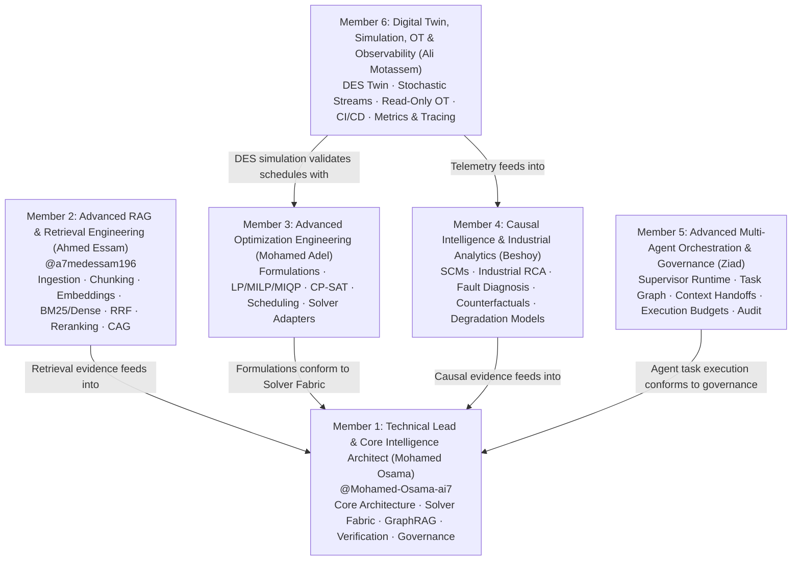

# QORVEXA — Six-Person Engineering Team Workstreams

**Document Status:** Official Team Governance & Subsystem Ownership Specification  
**Effective Date:** November 23, 2026  
**Product:** QORVEXA (Industrial Decision Intelligence Platform)  
**Team Composition:** 6 Human Engineers (AI assistants are developer tools, not team members)

---

## 1. Governance Principles

To maintain velocity, engineering rigor, and mathematical soundness without code collisions or architectural divergence:

1. **Clear Workstream Ownership:** Each contributor owns distinct subsystems, interfaces, benchmarks, and deliverables. No workstreams overlap or create competing implementations.
2. **Shared Contract Invariant:** Shared interfaces (Solver Fabric contracts, Canonical LP schemas, Fact Ledger, Units, Public REST APIs) are guarded by Technical Lead Mohamed Osama. No contributor may alter a shared contract without prior review and coordination.
3. **Evidence-Grounded Engineering:** All claims, formulations, causal assertions, and benchmark metrics must be backed by reproducible automated tests and empirical validation. Correlation must never be claimed as causation.
4. **Advisory Safety Boundary:** No workstream may implement write access, actuation protocols, or control pathways to physical industrial automation (PLCs, DCS, SCADA, RTUs). QORVEXA is an advisory decision intelligence system.

---

## 2. Six-Person Workstream Architecture

---

## 3. Workstream Allocations & Ownership Boundaries

### Member 1 — Technical Lead & Core Intelligence Architect: Mohamed Osama (`@Mohamed-Osama-ai7`)

**Primary Responsibilities:**
- **Overall System Architecture:** Technical roadmap, repository governance, cross-engine contract definitions, and release readiness.
- **Architecture Decision Records (ADRs):** Technical direction, framework evaluations, and architectural invariants.
- **Core Interfaces & Integration Standards:** Shared data contracts (`CanonicalLp`, `Fact`, `Proposal`, `DimensionalQuantity`, `IncidentEvent`).
- **Solver Fabric Architecture & Central Orchestration:** Subprocess worker protocol, JSON-IPC framing, memory watchdogs, execution timeout recovery, and multi-worker pool orchestration.
- **Optimization Architecture:** Advanced LP/MILP, robust, stochastic, and multi-objective optimization architecture and solver arbiter.
- **GraphRAG, Ontology Reasoning & Multi-Hop Reasoning:** Multi-hop graph traversal architecture, ontology reasoning, semantic hierarchy, and epistemic boundaries.
- **Adaptive Retrieval & Solver Selection Architecture:** Problem classification, paradigm routing, and solver selection.
- **Decision Intelligence & Governance:** Pareto frontier calculations, multi-criteria trade-off matrices, executive decision packages, and Fact Ledger tamper-evident hash chaining.
- **Platform Security & Acceptance:** Authentication, authorization, RBAC, tenant isolation, and final technical PR approval on shared contracts.

**Strict Ownership Boundaries:**
- Mohamed owns the central Solver Fabric architecture, worker execution protocols, and solver selection routing; Member 3 (Mohamed Adel) owns domain formulations, specific problem classes, and solver adapters.
- Mohamed owns central GraphRAG, multi-hop reasoning, and platform adaptive routing; Member 2 (Ahmed Essam) owns retrieval engine internals, ingestion, and search evaluation.

---

### Member 2 — Advanced RAG & Retrieval Engineering: Ahmed Essam (`@a7medessam196`)

**Primary Responsibilities:**
- **Document Ingestion & Structure-Aware Parsing:** Technical PDF extraction, maintenance manual chunking, asset passport parsing, and document provenance tracking.
- **Chunking & Multilingual Normalization:** Structure-aware markdown chunking, technical Arabic, English, and transliterated industrial shop-floor query normalization.
- **Embedding Adapters & Evaluation:** Embedding model evaluation, adapter interfaces, dimension validation, and latency benchmarking.
- **Search Engine Internals:** BM25 sparse keyword search, dense vector retrieval, and learned sparse retrieval.
- **Hybrid Retrieval & Fusion:** Reciprocal Rank Fusion (RRF), cross-encoder reranking, and deduplication.
- **Multi-Query Execution:** Multi-aspect retrieval execution and query decomposition.
- **Context-Augmented Generation (CAG):** In-memory cache structures, retrieval invalidation on document updates, and cache eviction policies.
- **Evidence Assessment & Corrective Retrieval:** Grounding verification, retrieval confidence scoring, and corrective retrieval fallback.
- **Retrieval Benchmarks:** Precision@K, Recall@K, MRR, and NDCG benchmarking against MetroPT-3 and industrial knowledge corpora (`retrieval_cases.*`).

**Strict Ownership Boundaries:**
- Ahmed owns retrieval internals, ingestion, embedding adapters, search fusion, and retrieval-specific evaluation.
- Ahmed does **not** own central GraphRAG architecture, ontology reasoning, multi-hop reasoning topology, or platform adaptive routing (owned by Member 1). Ahmed integrates retrieval components into Member 1's routing contracts.

---

### Member 3 — Advanced Optimization Engineering: Mohamed Adel (`[GitHub Handle Pending]`)

**Primary Responsibilities:**
- **Industrial Mathematical Formulations:** Specialized mathematical models for production planning, shift scheduling, machine sequencing, resource allocation, and cutting-stock problems.
- **Continuous & Discrete Solvers:** Mathematical formulations for mixed-integer programming (MILP), linear programming (LP), mixed-integer quadratic programming (MIQP) where mathematically justified, and network flow.
- **Constraint Programming:** Combinatorial optimization and constraint satisfaction formulations (e.g., OR-Tools CP-SAT).
- **Multi-Objective Optimization:** Pareto formulation models, weighted sum, and $\epsilon$-constraint formulations.
- **Stochastic & Robust Optimization Implementations:** Uncertainty-aware mathematical formulations and chance-constrained formulations.
- **Problem-Specific Solver Adapters:** Dedicated adapters conforming to the Solver Fabric worker contract.
- **Mathematical Validation & Benchmarks:** Formulation correctness, constraint tightness, and optimization benchmark suites (e.g., Cairo Food Processing, Alexandria Cable Manufacturing).

**Strict Ownership Boundaries:**
- Mohamed Adel owns problem formulations, mathematical models, optimization benchmarks, and solver adapters.
- Mohamed Adel does **not** own the central Solver Fabric architecture, worker execution protocols, or solver selection registry (owned by Member 1). All formulations must conform to Member 1's `CanonicalLp` and worker contract interfaces.

---

### Member 4 — Causal Intelligence & Industrial Analytics: Beshoy (`[GitHub Handle Pending]`)

**Primary Responsibilities:**
- **Causal Reasoning & Modeling:** Structural Causal Models (SCMs), Directed Acyclic Graphs (DAGs), observational conditioning, and interventional calculus ($do(X = x)$).
- **Industrial Root-Cause Analysis (RCA):** Automated hypothesis ranking, anomaly propagation tracing, and evidence-grounded incident explanation.
- **Fault Diagnosis & Failure Propagation:** Machine micro-state fault attribution, failure cascading models, and symptom-cause graphs.
- **Counterfactuals & What-If Analysis:** Counterfactual scenario evaluation assessing hypothetical asset recovery paths.
- **Predictive Maintenance & Anomaly Detection:** Degradation curve modeling, anomaly score calibration, and out-of-distribution (OOD) abstention.
- **Reliability & RUL Analytics:** Remaining Useful Life (RUL) estimation, hazard rates, Weibull degradation modeling, and equipment health indices.
- **Industrial Analytics Benchmarks:** RCA evaluation cases (`rca_cases.*`), calibration benchmarks against MetroPT-3, and AI4I milling data.

**Strict Ownership Boundaries:**
- All causal claims must remain evidence-based and rigorously distinguish statistical association from physical causation.
- Beshoy owns causal graphs, anomaly models, and predictive maintenance analytics.
- Beshoy does **not** own discrete-event simulation engine internals (owned by Member 6) or central decision intelligence packaging (owned by Member 1).

---

### Member 5 — Advanced Multi-Agent Orchestration & Governance: Ziad (`[GitHub Handle Pending]`)

**Primary Responsibilities:**
- **Agent Architecture & Supervisor Runtime:** Supervisor/specialist agent execution architecture, execution lifecycle, and agent state machines.
- **Task Decomposition & Workflow Coordination:** Industrial query decomposition into sub-tasks and dependency-aware DAG task execution.
- **Agent Communication & Context Handoffs:** Structured schema handoffs between specialized agents (e.g., retrieval agent to causal agent).
- **Execution Budgets, Timeouts & Cancellation:** Per-task token budgets, wall-clock timeout enforcement, and cooperative execution cancellation.
- **Retry & Failure Recovery:** Fallback strategies, graceful degradation when upstream services fail, and idempotent retry policies.
- **Agent Permissions & Governance:** Role-based agent tool access, untrusted output sanitization, fact-grounding verification, and audit trail generation.

**Strict Ownership Boundaries:**
- **Zero Actuation Invariant:** Agents cannot approve industrial decisions autonomously or control physical equipment. All decisions require authenticated human approval.
- Ziad owns agent supervision, workflow coordination, context handoffs, and execution budgets.
- Ziad does **not** own language understanding extraction logic (owned by Member 1) or retrieval engine internals (owned by Member 2).

---

### Member 6 — Digital Twin, Simulation, Industrial Integration, Deployment & Observability: Ali Motassem (`[GitHub Handle Pending]`)

**Primary Responsibilities:**
- **Digital Twin Foundations & Discrete-Event Simulation (DES):** Integer tick event clock, machine micro-states (`PROCESSING`, `STARVED`, `BLOCKED`, `DOWN`), buffer capacities, and scrap tracking.
- **Stochastic & Monte Carlo Simulation:** Independent pseudo-random streams per replication (deterministic SHA-256 seeding), failure distributions, and Monte Carlo scenario sweeps.
- **Production KPI & Capacity Analysis:** Bottleneck identification, throughput calculation, machine utilization, and line balancing.
- **Simulation-Based Schedule Evaluation:** Validating optimization schedules from Member 3 against simulated stochastic operational dynamics in the OSCO loop.
- **Read-Only Industrial Connectivity:** Advisory connectors and preflight validation for OPC UA, MQTT, and industrial historians. Telemetry normalization and timestamp alignment.
- **Deployment Execution & CI/CD:** GitHub Actions workflow maintenance, locked build pipelines, Docker containerization, and preview deployments.
- **Structured Logging, Metrics & Observability:** OpenTelemetry integration, structured JSON logs, latency tracing, memory profiling, and health endpoints.

**Strict Ownership Boundaries:**
- **Strict Read-Only Safety Boundary:** Absolutely zero write access, PLC setpoint changes, equipment actuation, or unauthorized factory network access.
- Ali owns Digital Twin simulation, OT connectivity descriptors, CI/CD pipelines, and platform observability.
- Ali does **not** own mathematical optimization formulations (owned by Member 3) or core Solver Fabric architecture (owned by Member 1).

---

## 4. Module Ownership Matrix

The following matrix maps every directory and subsystem in the repository to its primary owner and review requirements:

| Subsystem Path | Primary Module Owner | Secondary / Reviewer | Review Requirements |
|---|---|---|---|
| `backend/src/qorvexa/solver_fabric/` | **Member 1 (Mohamed Osama)** | Member 3 (Mohamed Adel) | Architect approval mandatory |
| `backend/src/qorvexa/contracts/` | **Member 1 (Mohamed Osama)** | All Members | Shared contract: Architect approval mandatory |
| `backend/src/qorvexa/industrial/units/` | **Member 1 (Mohamed Osama)** | Member 3 (Mohamed Adel) | Dimensional math review |
| `backend/src/qorvexa/industrial/governance/` | **Member 1 (Mohamed Osama)** | Member 5 (Ziad) | Governance & ledger audit |
| `backend/src/qorvexa/industrial/ontology/` | **Member 1 (Mohamed Osama)** | Member 2 (Ahmed Essam) | Entity resolution review |
| `backend/src/qorvexa/industrial/understanding/` | **Member 1 (Mohamed Osama)** | Member 2 (Ahmed Essam) | NLP & terminology review |
| `backend/src/qorvexa/industrial/decision_intelligence/` | **Member 1 (Mohamed Osama)** | Member 3 (Mohamed Adel) | Pareto & decision brief review |
| `backend/src/qorvexa/api/` | **Member 1 (Mohamed Osama)** | Member 6 (Ali Motassem) | API contract & safety review |
| `backend/src/qorvexa/knowledge/` | **Member 2 (Ahmed Essam)** | Member 1 (Mohamed Osama) | Retrieval & chunking review |
| `backend/benchmarks/qorvexa/retrieval_cases*` | **Member 2 (Ahmed Essam)** | Member 1 (Mohamed Osama) | Retrieval benchmark review |
| `backend/src/qorvexa/industrial/formulation/` | **Member 3 (Mohamed Adel)** | Member 1 (Mohamed Osama) | Formulation & LP review |
| `backend/src/qorvexa/industrial/production_planning/` | **Member 3 (Mohamed Adel)** | Member 6 (Ali Motassem) | Planning model review |
| `backend/benchmarks/qorvexa/planning_cases*` | **Member 3 (Mohamed Adel)** | Member 1 (Mohamed Osama) | Optimization benchmark review |
| `backend/src/qorvexa/causal/` | **Member 4 (Beshoy)** | Member 1 (Mohamed Osama) | Causal graph review |
| `backend/src/qorvexa/anomaly/` | **Member 4 (Beshoy)** | Member 6 (Ali Motassem) | Anomaly algorithm review |
| `backend/src/qorvexa/ml/` | **Member 4 (Beshoy)** | Member 6 (Ali Motassem) | Model calibration review |
| `backend/benchmarks/qorvexa/rca_cases*` | **Member 4 (Beshoy)** | Member 1 (Mohamed Osama) | RCA benchmark review |
| `backend/src/qorvexa/agents/` | **Member 5 (Ziad)** | Member 1 (Mohamed Osama) | Agent governance review |
| `backend/src/qorvexa/copilot/` | **Member 5 (Ziad)** | Member 4 (Beshoy) | Copilot prompt & guardrail review |
| `backend/src/qorvexa/industrial/digital_twin/` | **Member 6 (Ali Motassem)** | Member 3 (Mohamed Adel) | Simulation dynamics review |
| `backend/src/qorvexa/industrial/co_orchestration/` | **Member 6 (Ali Motassem)** | Member 1 / Member 3 | OSCO closed-loop review |
| `backend/src/qorvexa/connectors/` | **Member 6 (Ali Motassem)** | Member 1 (Mohamed Osama) | Safety boundary verification |
| `.github/workflows/` | **Member 6 (Ali Motassem)** | Member 1 (Mohamed Osama) | CI/CD pipeline integrity review |
| `frontend/src/features/planning/` | **Member 3 (Mohamed Adel)** | Member 1 (Mohamed Osama) | UI workflow review |
| `frontend/src/features/solver/` | **Member 1 (Mohamed Osama)** | Member 3 (Mohamed Adel) | Solver UI telemetry review |
| `frontend/src/features/knowledge/` | **Member 2 (Ahmed Essam)** | Member 1 (Mohamed Osama) | Knowledge explorer review |
| `frontend/src/features/incidents/` | **Member 4 (Beshoy)** | Member 5 (Ziad) | Incident & evidence review |
| `frontend/src/features/twin/` | **Member 6 (Ali Motassem)** | Member 3 (Mohamed Adel) | Twin simulation UI review |
| `frontend/src/features/edge/` | **Member 6 (Ali Motassem)** | Member 1 (Mohamed Osama) | Connector UI review |

---

## 5. Cross-Workstream Integration Rules

1. **Contract-First Invariant:** If your feature requires altering an existing dataclass, Pydantic model, or API endpoint in `qorvexa/contracts/` or `qorvexa/api/`, you must open a design RFC or issue first and obtain Member 1's sign-off before modifying implementation code.
2. **Zero Code Duplication:** Before writing any mathematical utility, string parser, unit converter, or file reader, inspect existing modules (`qorvexa.industrial.units`, `qorvexa.industrial.governance`, `qorvexa.solver_fabric`).
3. **Hermetic Test Discipline:** Every pull request must include unit and integration tests that run completely hermetically (offline, CPU-executable, deterministic).
4. **CI/CD Exclusivity:** No team member other than Member 6 (Ali Motassem) may modify files under `.github/workflows/` without direct coordination.
5. **Physical OT Safety Boundary:** Absolutely no code may introduce socket write operations, setpoint commands, or actuation calls to physical industrial controllers.
